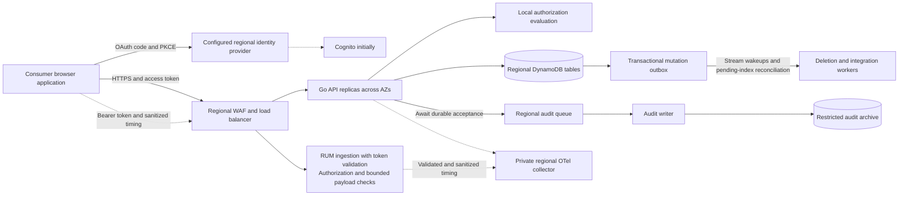

# Patient contact API — architecture proposal

Status: draft for technical review; no deployed system or measured performance claim.
Date: 2026-10-22.
Scope: standalone theoretical health-organization system. Technology choices derive from this project's requirements; no dependency on the user's existing organizations, projects, frameworks or tooling is assumed.

## Confirmed requirements

- 20,000 customer organizations, isolated tenants; patient lookup never crosses organizations.
- 10 million patient records and 20,000 requests/second across the whole system.
- Exact phone lookup and patient-detail reads: browser-to-visible-result p95 below 100 ms for a defined US user/network population.
- US first, with future international deployment and regional customer-data segregation.
- REST API; React/Node.js frontend ecosystem; Go backend; pluggable identity providers with AWS Cognito as the initial provider.
- Contract-first UI and entity definitions, future backend field restrictions, safe logging, right-to-erasure workflow, and OpenTelemetry.
- Fixed entity schema initially. Runtime customer-defined fields are out of scope.

Guidance: `docs/project-standards.md`. This standalone design assumes AWS services where suitable, Kubernetes/EKS deployment, and an API-owned boundary. Full architecture, ERD and sequence diagrams are in `docs/diagrams.md`.

## Recommendation and alternatives

A consumer application, such as the currently expected React frontend, calls a regional Go API with Cognito through a replaceable identity adapter, **DynamoDB as the primary store**, and regional SQS workers. The consuming team selects its frontend implementation. The user's preference for managed horizontal growth and the fixed exact-phone/patient-ID access patterns favor DynamoDB at the long-term design horizon. Keep the lookup path bounded, with locally verified identity, backend-controlled authorization, explicit response projection, and durable audit acceptance before disclosure. Performance and cost remain subject to measurement.

| Choice | Decision and rationale | Limit |
|---|---|---|
| DynamoDB | Recommended primary store; pooled regional tables, distributed tenant/item keys, strongly consistent primary-table reads, transactional mutations | Explicit access-pattern modeling, read/write amplification, hot keys, quotas, and reconciliation require testing |
| Aurora PostgreSQL | Earlier candidate, not selected for this revision; attractive relational queries and transactions | LIST partitions do not distribute compute; the expanded scale would require managed cell/shard growth and operational maintenance |
| Redis or another patient database | Not proposed | Additional sensitive copies and synchronization are unnecessary for the selected access patterns |

The previous PostgreSQL recommendation addressed the original 10-million-record workload. This revision changes the primary-store decision for the user's long-term scale preference; it does not claim PostgreSQL cannot store billions of rows. The REST/entity contract and privacy requirements remain unchanged. No dual-database synchronization layer is proposed.

### Long-term scale clarification — 2026-10-22

The design horizon includes hundreds of millions of people, each potentially represented at multiple independently owned organizations. Population multiplied by every organization relationship is an upper scenario, not a forecast. Adoption must reflect the relevant customer market and country: a hypothetical 30% of US organizations is not automatically 30% of people or records, and larger international markets can have lower penetration. Model organization size, represented patients, overlap, retained histories, and geographic adoption explicitly; see `capacity-model.md`. Patient-organization records remain isolated even when the same person appears in several tenants.

Use pooled tables within each regional cell and distribute each tenant across patient and phone keys. Do not use a single `PK=ORG#id` for all patient traffic, create one table per organization, or infer data residency from a phone number. A key prefix is not authorization: trusted membership, backend checks, IAM, and table/cell ownership all remain required. No global patient identity or cross-tenant deduplication is introduced.

The [security review](docs/security-review.md) records the threat model, concrete design findings and required negative evidence. Its request, abuse, key and audit profiles complement the detailed identity, event and delivery specifications; documented controls are not implemented security proof.

## Deployment and request flow

Use an ALB with AWS WAF and autoscaled, continuously running Go pods on Amazon EKS across availability zones. EKS replaces the earlier ECS assumption. Pods run in private network placement and use scoped IAM workload identity; reach regional DynamoDB through a configured VPC endpoint and restrictive IAM/endpoint policies. Only controlled authenticated application ingress is public. Keep spare capacity; autoscaling reacts too late to be the only defense against sudden bursts. Use bounded queues, request deadlines, tenant fairness and backpressure. No cold-start dependency on the lookup path. Shared preview, production and isolated engineer/PR environments follow `docs/delivery-and-environments.md`.

The [delivery security baseline](docs/delivery-and-environments.md) defines production pod admission, RBAC/service-account selection, node-credential isolation, egress and operator access. Use HTTPS on the backend hop, but do not claim ALB target HTTPS authenticates the target certificate; control target registration and reachability and qualify any stronger workload-authentication requirement. WAF logging redaction and sampled-request protection are separate settings.

Browser RUM uses a controlled ingestion endpoint that independently validates the bearer token and current authorization before forwarding sanitized timing to the private regional collector. Bind allowed context to the verified principal; enforce an allowlisted bounded schema, payload size and rate limits, and reject patient values, raw claims and arbitrary export destinations. Never expose ADOT/OTLP directly to browsers. Define and qualify this observability transport contract separately; it is not an additional operation in the current seven-operation patient/session OpenAPI contract.

Use qualified hardened container images for AWS workloads under [image maintenance](docs/image-maintenance.md), with exact reviewed versions/digests and the specified rebuild/remediation process. [API testing](docs/api-testing.md) defines the required contract, security, integration and performance evidence. These standards specify future controls; no image pipeline, application code or test implementation is supplied by this draft.

This project owns the stable API and consumer-contract boundary, not frontend construction. Node.js is used for contract tooling where needed; current stable React is a consumer assumption. The consuming team owns its build framework, application state, rendering, SSR/BFF decisions and token-storage implementation within agreed security requirements. The service team provides the authenticated contract and conformance evidence. Any consumer-added hop or token refresh remains part of the joint browser-visible latency measurement.

Frontend hosting is owned by the consuming team. Patient API responses use `Cache-Control: no-store`; do not place them in a shared CDN cache. Regional API locations are resolved from authenticated tenant configuration before patient input is transmitted. The frontend clears patient state when switching tenants.

### Regional cells

A cell is an independently capacity-managed deployment: API replicas, database, workers, queue, keys, audit, and telemetry destinations. An authoritative directory maps `tenantId → residencyBoundary → AWS region → cell`. Cache only bounded-fresh routing metadata on the request path. Tenant migration is an explicit, fenced operation; no ad hoc dual writes.

- Start the capacity exercise in a US region; choose launch cells and US East/West placement from actual user geography and load tests.
- US geography alone does not guarantee a sub-100 ms round trip. Tenants with users on both coasts need an explicit supported population and routing decision.
- A future EU or other regional deployment has its own patient tables, keys, queues, audit, backups, and appropriate identity deployment. No automatic worldwide replication of patient data. Verify service availability and identity capabilities for each destination before promising the US stack there.
- Residency follows the customer's approved placement, never phone prefix, address, browser IP, or caller-supplied region.
- Global routing metadata contains the minimum tenant routing information and has its own classification/access policy; it is not a global patient directory.
- Multi-AZ availability and regional disaster recovery are separate decisions. Cross-region replicas/backups require approved residency destinations and stated RPO/RTO.

AWS China is a separate deployment review: the `aws-cn` partition has separate accounts/IAM and service availability; current China documentation does not provide Cognito User Pools. Cognito is the initial US adapter, not a mandatory dependency of future regional deployments. Select and validate a suitable local provider against the shared identity contract before launching a new market; never route around that region's identity or data boundary automatically. [AWS China Cognito differences](https://docs.amazonaws.cn/en_us/aws/latest/userguide/cognito.html).

Every regional API verifies trusted tenant-to-cell ownership and migration generation before reading or mutating patient data. Stale-session or wrong-cell requests fail safely; no automatic cross-region database fallback or redirect that replays a patient-bearing POST. Migration fencing invalidates the old owner before the new owner serves requests.

Application domain and audit events follow [event contracts](docs/events.md): CloudEvents envelopes, AsyncAPI channel/message definitions and separately versioned payload semantics. REST uses the OpenAPI contract below. The durable mutation outbox remains the reliable publication boundary; EventBridge fan-out is an optional later adapter, not an additional lookup dependency.

## API and entity contracts

`openapi.json` is the canonical transport and entity contract. Its `components.schemas` are the shared entity definitions; avoid manually maintaining a second TypeScript model and Go JSON model.

| Endpoint | UI purpose |
|---|---|
| `GET /v1/session` | Authorized organization choices, regional endpoints, and capability context |
| `POST /v1/tenants/{tenantId}/patient-lookups` | Exact phone lookup, returning the authorized patient fields needed to render results in one response |
| `GET /v1/tenants/{tenantId}/patients/{patientId}` | Patient detail or refresh |
| `POST /v1/tenants/{tenantId}/patients` | Create with idempotency protection |
| `PATCH /v1/tenants/{tenantId}/patients/{patientId}` | Authorized partial update with optimistic concurrency |
| `POST /v1/tenants/{tenantId}/erasure-requests` | Initiate a tracked erasure workflow; `202` is acceptance, not deletion completion |
| `GET /v1/tenants/{tenantId}/erasure-requests/{requestId}` | Authorized progress, retention decision, and completion state |

Tenant IDs in paths select a scope; verified backend membership grants it. Wrong-tenant and absent patient IDs have the same public not-found behavior. No cross-tenant search, global patient count, or phone-based patient identifier.

Use OpenAPI 3.2.1, the latest published specification verified on 2026-10-22. `info.version` is the independent API SemVer; the current 0.1.0 document is an unreleased proposal for future `/v1` GA. Publish immutable generated JSON/YAML and consumer-contract artifacts from the canonical source. Qualify exact Go/consumer generators, validators and compatibility-diff tools before implementation; currently inspected `oapi-codegen` release notes describe initial 3.1 support and do not prove 3.2.1 compatibility. Do not silently downgrade the specification. Generated types are not runtime validation or authorization, and frontend framework choices remain outside scope. [OpenAPI 3.2.1](https://spec.openapis.org/oas/v3.2.1.html), [generator release evidence](https://github.com/oapi-codegen/oapi-codegen/releases).

Every request supplies `API-Version: MAJOR.MINOR.PATCH` consistent with the path major; successful selection is reflected in the response `API-Version` header. Missing, unknown or retired selectors never fall back. Exact contract views can share a patched implementation without changing their identity.

The strict request profile in `openapi.json` and [security review](docs/security-review.md) bounds bytes, depth, header ambiguity, media types and decoding. Reject duplicate decoded JSON members, invalid Unicode, trailing documents and case-mismatched properties; authorization and mutation must consume the same validated input. Edge transport rejection is distinct from authentication-first application handling. Budget work per principal/tenant/operation/cell, including read and audit amplification.

Public DTOs, internal domain records, and DynamoDB persistence items are separate types. The API contract drives UI behavior; the database schema is not a serialization API.

| Domain field | Representation and behavior |
|---|---|
| Patient ID | Opaque, immutable, tenant-scoped identity; unrelated to phone number |
| Name | Unicode display name and optional structured parts; do not assume every name has US-style first/last components |
| Phones | Bounded array; canonical E.164 string and separate extension; numbers can be shared |
| Address | Country code, lines, locality, administrative area, string postal code; US UI labels these City, State, ZIP |
| Comment | Bounded plain text; sensitive by default; no HTML rendering or operational logging |
| Revision | Opaque concurrency token; not a timestamp or business identifier |
| Access metadata | Backend-calculated field capabilities and policy version; contains no withheld values |

Read semantics: absent = not disclosed; null = authorized but no value; present value = disclosed. The phones collection uses an empty array when authorized and empty. Do not return placeholder strings such as `***` as data. Capability metadata is policy-derived and must not reveal whether a hidden field has a stored value.

Container existence and collection cardinality are classified disclosures too. A parent-group read permission explicitly permits its existence/cardinality; child permissions govern its values. Without the parent permission, omit the entire container, never empty placeholders for hidden items. A hidden child's presence must not change a disclosed parent's nullness or counts. Opaque concurrency metadata can indicate the record changed, but cannot identify a hidden field or its value.

Write semantics: absent PATCH property = unchanged; explicit null = clear only where the contract allows it. Go transport decoding must preserve absent/null/value. Reject unknown fields and denied field writes atomically; never silently ignore them. `If-Match` prevents lost updates. The read `version` is an opaque token bound to tenant, patient revision, authorization view, and policy version; its quoted form is the single-record ETag. Different field projections must not share a strong ETag. Lookup items carry the equivalent detail token. Create and erasure requests use tenant/principal-scoped idempotency keys, bounded retention, and request fingerprints; replays must recheck current authorization and must not replay a stored over-privileged response or resurrect erased data.

Phone lookup uses POST so values do not enter URL query strings or browser history. Disable body capture too. No-match is an empty successful collection. Shared numbers return a bounded authorized collection with an opaque cursor. Bind cursors to tenant, principal/authorization scope, policy version, normalized search, expiry, exact API-Version, cursor codec and normalization/ordering semantics; encrypt any embedded patient/search information or keep it server-side. A signature alone does not conceal it.

Use RFC 9457 problem responses, stable machine-readable codes, field paths without submitted values, and a request ID. Do not include phone inputs, token claims, raw datastore errors, or hidden-record existence in errors. [Problem Details](https://www.rfc-editor.org/rfc/rfc9457.html).

The UI must handle loading, no matches, multiple matches, readable-but-empty, restricted fields, expired session, permission changes, validation failure, version conflict, throttling, temporary failure, and pending/retained/complete erasure. Return sufficient result fields in the lookup response to avoid a serial detail fetch inside the lookup latency objective.

All declared API operations require a valid bearer access token and backend authorization, including session discovery. The service authenticates before returning version-negotiation or resource-specific outcomes; invalid/missing credentials receive 401. Schema/lifecycle documents are protected too. Narrow browser CORS preflight is transport negotiation only and exposes no business data; readiness/liveness is private infrastructure, not an anonymous application endpoint. Version selection, request/response headers, configurable support counts, explicit retention overrides and automatic decommissioning follow `docs/api-versioning.md`; every supported representation retains the same security and erasure controls.

## Storage and number handling

Use pooled regional DynamoDB tables: patient/contact and lookup items in a patient-data table; backend membership, erasure, tombstone, idempotency, routing, and mutation-outbox items in appropriately restricted control tables in the same account/Region where atomic updates are required. This is one datastore technology, not a second application database. Avoid LSIs. IAM grants API and worker roles only their required table/index actions; never accept table names or complete partition keys from clients.

| Item/access path | Primary key design | Contents |
|---|---|---|
| Authoritative patient detail | `PK=ORG#<tenant>#PATIENT#<patient>`, `SK=CONTACT` | Typed bounded contact fields, current phone associations, revision, state, deletion generation |
| Exact phone mapping | `PK=ORG#<tenant>#PHONE#<keyVersion>#<tenantPhoneHmac>`, `SK=PATIENT#<patient>` | Patient reference, association/revision information; no copied contact response |
| Operational tenant inventory | `PK=ORG#<tenant>#INVENTORY#<bucket>`, `SK=PATIENT#<patient>` | Reference only; fixed configured bucket set for tenant jobs |
| Durable mutation outbox | Unique event key; sparse pending GSI keyed by bounded shard and sortable next-attempt time/event ID | Reference-only event, patient/deletion generation, status, lease and retry evidence |

Every item key, request, transaction, event, cursor, and job binds trusted tenant scope. Patient IDs are opaque; phone mappings are deliberately one-to-many. Phone HMACs are versioned tenant-scoped keyed digests, remain restricted metadata, and must never enter logs. They reduce raw-phone exposure in storage keys but do not provide authorization or anonymization. Secure key lifecycle/caching and bounded dual-version lookups during rotation need implementation design; no synchronous KMS call per lookup.

Exact lookup performs a primary-table `Query` with `ConsistentRead=true` on the tenant/phone key, followed by one bounded `BatchGetItem` with strongly consistent reads for the patient candidates (the current contract allows at most 20 returned matches/page). Explicitly reassemble batch results, handle `UnprocessedKeys`, and budget retries within the request deadline. Verify each current patient's tenant, active state, deletion generation, current normalized base-phone association, and expected revision before projection. Query and BatchGet are separate reads, not one snapshot: a mismatched association/revision triggers bounded re-evaluation; unresolved churn fails safely instead of disclosing stale data or fabricating a no-match result. Detail uses a strongly consistent `GetItem` and the same authorization/projection controls. [DynamoDB read consistency](https://docs.aws.amazon.com/amazondynamodb/latest/developerguide/HowItWorks.ReadConsistency.html).

Authorization filtering occurs before reporting matches/counts and constructing cursors. Bound candidate reads/overscan as well as result count; continuation contains only the opaque, policy-bound cursor defined by the API contract. Do not depend on a DynamoDB `FilterExpression` as authorization or confuse its evaluated-item limit with an authorized result limit. Shared-number hotspots require measured per-key controls; sharding a hot phone key would add fan-out and is a separately validated change. No full-table scan or eventually consistent GSI participates in patient disclosure.

Create/update/restrict operations use `TransactWriteItems` with conditional revision/deletion checks. The contract caps phones at ten: maintain the patient and all affected mapping revisions, remove obsolete associations, update inventory where needed, and persist the durable outbox/idempotency records atomically. Compute distinct item operations so no transaction targets the same item twice. Enforce transaction action/byte limits and DynamoDB's item-size limit before writes; bounded API fields are not a substitute for encoded-item size checks. DynamoDB supports up to 100 actions/4 MB per transaction; transactions cost more capacity than ordinary writes. Service transaction-token idempotency lasts ten minutes, so the API's longer idempotency contract requires its own protected persisted record and replay checks. [Transactions](https://docs.aws.amazon.com/amazondynamodb/latest/developerguide/transaction-apis.html).

Mutation outbox records remain pending until downstream durable acknowledgment and completion evidence are stored. DynamoDB Streams can wake workers quickly, preferably with keys-only records to avoid extra contact images, but its 24-hour retention is not the recovery mechanism. Scheduled workers query every configured shard of a sparse pending-outbox GSI, including expired leases/overdue retries, and strongly read/conditionally claim the underlying event. The GSI is discovery only: eventual propagation is acceptable for retry discovery, never disclosure authority. Lease expiry, idempotent downstream events, periodic reconciliation, backlog/age alarms, and retained pending records allow recovery after outages longer than stream retention. Completed records acquire their separately approved retention/expiry only after success; pending records never expire merely because a stream event was missed. [DynamoDB Streams](https://docs.aws.amazon.com/amazondynamodb/latest/developerguide/Streams.html).

Maintain the sharded tenant inventory transactionally with creates and final removals. Tenant jobs enumerate its known buckets with checkpoints and strong record validation, without a hot-path table scan; global reconciliation or export is an explicit off-path operation with a capacity budget. This operational inventory does not expose a new public bulk-search API. Index sharding and bucket counts are measured configuration choices, not unbounded tenant-cardinality indexes.

Use maintained libphonenumber-compatible parsing metadata on ingestion and search. National input requires an explicit parsing country; US is an initial tenant/UI default, not a permanent backend assumption. E.164 values are strings; ZIP/postal codes and extensions are strings too. Store the extension separately as metadata; the current API matches the base E.164 number only and accepts no extension filter. Display formatting is separate from canonical comparison. Validation does not prove ownership/reachability; `+1` is not a unique country. [Phone-number assumptions](https://github.com/google/libphonenumber/blob/master/FALSEHOODS.md).

Baseline encryption: TLS, encrypted tables/backups with customer-managed KMS keys scoped by environment/cell/data purpose, separate key administration/use permissions, least-privilege application/operator access, and managed secrets. A shared cell-wide DynamoDB role can access multiple tenants; key prefixes and encryption at rest do not prevent a compromised authorized role from reading them. Separate data, policy-administration, publisher, consumer, audit and restore roles, restrict their actions/resources, and explicitly accept that residual cell boundary under [ADR-0005](decisions/0005-bound-pooled-cell-security.md). Qualify dedicated cells/accounts for customers requiring stronger workload isolation. Phone HMAC, cursor and idempotency keys use separate purposes and versioned rotation/recovery under the [key lifecycle requirements](docs/security-review.md); historical usable keys prevent claims of cryptographic erasure. Application-level encryption of patient field values is a separate threat-model decision, not a substitute for authorization. Key rotation and erasure must cover keys, mappings, backups, streams, and protected operational references.

Prefer on-demand capacity initially, subject to modeled request cost and confirmed table/index/account quotas; evaluate provisioned capacity for predictable sustained demand. Read and validate warm throughput before load tests/launch, and pre-warm tables/indexes where needed. Pre-warming is a paid capacity preparation mechanism, not a latency guarantee or a cure for hot keys. Plan for strong-read amplification, transaction amplification, retries, skew, and background workers rather than equating 20k API RPS to 20k DynamoDB reads. [Warm throughput](https://docs.aws.amazon.com/amazondynamodb/latest/developerguide/warm-throughput.html).

## Pluggable identity and backend authorization

Identity-provider pluggability, stateless request handling and customizable personas are confirmed requirements. Persona templates, permission delegation, token claim contracts and the limits of token-only revocation are specified in `docs/identity-and-personas.md`. Each service validates credentials and authorizes its operations; trusted network placement alone does not authorize a call. Identity-provider pluggability is a confirmed requirement. Use a small regional provider registry and adapter contract, with Cognito implemented first. Standardize browser sign-in on OIDC Authorization Code with PKCE and API credentials on signed JWT access tokens from explicitly configured issuers. OIDC alone does not guarantee a provider issues suitable API access tokens; each adapter must validate its provider's token profile. A future opaque-token-only or SAML-only provider requires an explicitly designed regional integration, not per-patient-request remote introspection or acceptance of ID tokens. No central worldwide identity broker is required. See `decisions/0001-pluggable-regional-identity.md`.

| Boundary | Shared contract | Provider-specific responsibility |
|---|---|---|
| Consumer authentication client | Sign in, obtain/refresh an access token, sign out; UI reads capabilities from `/v1/session` | Trusted regional issuer/client/redirect configuration, supported logout and refresh behavior |
| Go token verifier | Validated external identity and normalized authentication context | Token type, algorithms, keys, issuer, intended API/client binding, expiry, scopes, MFA/assurance and session claim semantics |
| Application identity resolver | `(trusted issuer, subject) → immutable application principalId` | Controlled identity provisioning, linking, migration and disabling |
| Application authorization | Current tenant membership, action/search/row/field policy, revocation state | Remains backend-owned for every provider |

The browser receives public login configuration from its trusted regional deployment before sign-in; `/v1/session` remains authenticated and is not needed to discover the initial provider. Never let a URL parameter or entered email supply an arbitrary issuer or redirect destination. Multiple configured providers may coexist during an approved migration, but selection never grants tenant membership. Use a reviewed OIDC library to enforce PKCE, state, nonce and redirect checks; never embed a public-client secret. For direct SPA access, keep tokens in memory, enforce a restrictive CSP and dependency controls, and use exact CORS origins and only necessary methods/headers. Persistent browser token storage is not the default. Bind multi-provider callbacks to the initiating issuer/client/transaction and qualify refresh rotation/replay, stable session binding and separate local/provider/application logout outcomes. Privileged grants, recovery and emergency operations need recent phishing-resistant step-up and independent approval under [identity and personas](docs/identity-and-personas.md). Require MFA according to application policy using verified provider-specific assurance mappings; missing or unmapped assurance fails closed when required.

Go validates access tokens locally against a trusted allowlist: allowed algorithm and signing key, signature, exact issuer, expiry/not-before, token purpose, configured API/client binding, subject and required scopes. For Cognito this includes `token_use=access`, expected `client_id`, and audience where the configured token profile includes one; other providers use their explicitly configured audience/client and access-token validation rules. An unverified issuer may only select an already configured verifier and must then be verified; it cannot trigger arbitrary discovery or network access. Bind key types and algorithms to the trusted issuer profile; token-provided key URLs or embedded keys cannot establish trust. Cache issuer-scoped JWKS with bounded, coalesced, rate-limited refresh, negative caching and explicit last-trusted-key expiry. Flooded or unknown keys never authenticate; each adapter qualifies outage and rotation behavior. Do not call any provider's user-info or introspection endpoint for each lookup. [Cognito verification](https://docs.aws.amazon.com/cognito/latest/developerguide/amazon-cognito-user-pools-using-tokens-verifying-a-jwt.html), [JWT validation guidance](https://www.rfc-editor.org/rfc/rfc8725.html).

Map the verified issuer/subject pair to an immutable application principal in the relevant regional identity domain. `/v1/session.subjectId`, membership, audit actor references, policy bindings and idempotency ownership use that internal principal, never a raw Cognito `sub`. An issuer's subject is not globally unique, and email is not an identity-linking key. Link or migrate identities only through an authenticated, authorized ownership-verification process with audit evidence; never auto-merge accounts on matching email, name or phone. Keep identity mappings and minimal authentication context restricted and regional; do not log raw claims or tokens. [OIDC subject identifiers](https://openid.net/specs/openid-connect-core-1_0.html#SubjectIDTypes).

Identity providers establish identity and coarse scopes. Backend-owned membership and policy determine tenant access, record access, field read/write rights, and whether searching a field is permitted. Provider groups or roles never become application grants without an explicit trusted mapping and current policy evaluation. Roles map to permissions; do not encode a single numeric access level as the entire policy model. The canonical API capabilities are `patients.lookup.phone`, `patients.read`, `patients.create`, `patients.update`, and `patients.erase`, supplemented by field-specific read/write grants.

Evaluate versioned policies locally with an authenticated distribution mechanism. Proposed initial bound: backend-accepted membership/session/policy revocations propagate within 5 seconds; a node whose authorization snapshot cannot prove freshness beyond that bound fails closed for protected operations. Acceptance means the authoritative change and distribution work are durably committed. The total bound includes publication, distribution, application, clock uncertainty and the remaining decision lifetime; it is not five additional seconds per stage. This bound starts when the application accepts the change; it does not cover an unseen provider-side logout or account disable. A provider-originated revocation bound requires a proven bounded event/feed mechanism or a separately approved session/token-lifetime policy. These timings require acceptance and load/failure testing, not a Cognito guarantee. Immediate revocation would require a stronger authoritative check on each disclosure and a revised latency budget. Revoked Cognito tokens can still pass ordinary offline JWT verification; short token life alone is insufficient. [Cognito revocation](https://docs.aws.amazon.com/cognito/latest/developerguide/token-revocation.html).

Freshness requires authoritative versions/watermarks, source timestamps with bounded clock assumptions, and missing/out-of-order update detection. A watermark must establish there is no missing committed change; a distribution heartbeat alone is insufficient. Restarted API nodes acquire a fresh snapshot before readiness. Carry an authorization validity deadline through DynamoDB reads/retries and audit waiting; recheck before side-effect dispatch and disclosure and reject when it expires or an observed revocation invalidates the decision. A remote write already dispatched can commit later unless its authoritative transaction condition fences the change; cancellation alone does not prove noncommit. Valid credentials with unavailable/unproven policy freshness receive safe 503; known revoked credentials receive 401 and known permission denials 403 or concealed 404.

Each adapter must document how logout, session revocation, account disabling, key rotation and provider outages affect this freshness contract. The application-controlled denial state is authoritative for application revocation; disabling a provider account alone is not proof that existing access tokens are immediately unusable. A provider that cannot meet required revocation/assurance behavior is not an approved adapter. Provider migration preserves the internal principal and authorization history, uses explicit linking, and revokes old sessions when cut over. Provider failure never silently selects another issuer or region. Login/refresh availability and existing-token verification availability are measured separately.

Any permission-cache key binds every decision input, including resource authorization revision, issuer/client/session/token context, assurance, purpose and time. Projection reuse also binds exact API-Version, record revision and disclosed field set, with the earliest validity deadline; no patient-response cache is introduced.

Use a static policy-field registry now, even if initial policies are permissive. Metadata includes classification, readable/writable/search permissions, and telemetry handling. Child fields such as address postal code need policy identities, not only a single all-or-nothing patient flag. OpenAPI extensions document the mapping; backend code must explicitly enforce it.

Enforcement order: validate identity → bind tenant/membership → authorize operation/search → fetch within tenant and deletion scope → authorize/project fields → durably record disclosure intent → return. Record-level policy must be applied before paginating and before reporting existence/counts. Searching a hidden phone field may reveal patient existence, so search permission is distinct from display permission.

New fields default to no disclosure and no telemetry until classified and authorized. The same registry informs response projection, update allowlists, exports, logging wrappers, and tests. There is no generic runtime schema-extension engine in v1.

## Logging, tracing, and audit

Operational telemetry uses a stricter policy than the caller's UI permissions: patient values never enter ordinary logs or traces, even for administrators. Allowlist route templates, status/error classes, deployment, cell/region, dependency, duration, and generated request/trace IDs. Treat correlation identifiers as restricted operational metadata with retention/access rules. Generate server request IDs, validate bounded incoming trace context, discard arbitrary baggage/tracestate and prevent caller sampling flags from forcing unbounded tracing or cost.

Exclude request/response bodies, tokens/cookies, names, phone values, addresses, comments, DynamoDB expression values and item payloads, raw error payloads, and PII-bearing URLs. Patient/user/tenant IDs, IPs, and phone HMACs are linkable data, not anonymous identifiers. Do not use them as metric labels or default baggage. Redact or segregate raw access logs that inevitably contain opaque resource IDs. Disable session replay/DOM capture for patient screens unless separately designed and approved.

Enforce this at the application source, then use collector allowlisting/redaction as defense in depth. Review ALB/WAF access logs and sampled requests, DynamoDB SDK/debug logging and CloudTrail/data-event configuration, proxies, browser analytics, crash reports, and third-party agents separately. OTel does not automatically identify all sensitive data. [OTel sensitive-data guidance](https://opentelemetry.io/docs/security/handling-sensitive-data/).

Access audit is separate from sampled operational telemetry. A restricted audit event includes event ID, actor reference, tenant/patient reference where necessary, operation, decision, disclosed field categories, policy version, timestamp, and request ID; never contact values. These references are still protected personal/linkable data.

Proposed transport: cell-local SQS Standard. Await a successful durable `SendMessage` acknowledgment before releasing protected data, then asynchronously archive through an idempotent consumer into a restricted regional audit store. Freeze the exact safe response projection and its audit references/categories together. After acknowledgment, recheck authorization/erasure validity and deadline before disclosure; a changed projection requires corresponding new durable intent. An audit event describes authorization/disclosure intent, not proof the browser received it. Duplicates and out-of-order delivery are expected; use event IDs and versions. Delete queue messages only after durable sink acceptance. On an ambiguous send result, retry with the same event ID; duplicates must be harmless. If durable audit is unavailable, fail closed unless an explicitly designed independent durable fallback exists. [SQS Standard durability and delivery](https://docs.aws.amazon.com/AWSSimpleQueueService/latest/SQSDeveloperGuide/standard-queues.html).

Privileged control changes also need durable security audit: membership/persona changes, identity linking/recovery, hold/erasure decisions, provider/key trust, release policy and emergency access. Couple these state mutations to protected audit/outbox evidence; define their separate management contracts before implementation. Rejected unauthenticated floods use bounded security detection rather than an unlimited synchronous queue write per packet.

Do not add every read-audit insert to the patient database's mutation outbox. Reserve that transactional outbox for writes/deletion events that must commit atomically with data changes. SQS's durable acknowledgment does not prove a particular latency; benchmark it in the real region. [SQS reliability](https://docs.aws.amazon.com/AWSSimpleQueueService/latest/SQSDeveloperGuide/sqs-basic-architecture.html).

At sustained 20,000 disclosures/second, one audit event/request produces 1.728 billion events/day. At 1 KB/event this is approximately 1.7 TB/day before compression, indexing, and replicas. Audit retention, aggregation of multiple record references per request, archive format, queue outage capacity, and cost are launch decisions. Mandatory audits cannot be sampled away. Protect queue/DLQ/archive contents, monitor oldest-message age, and prevent expiry before archival.

Track original event creation time across queue and DLQ, not only queue-specific age metrics. Define an archive-outage alarm and admission-stop threshold with recovery headroom before retention expiry, plus emergency durable preservation of already accepted events. Stopping new disclosures does not preserve the old backlog by itself. SQS is transport, not the long-term archive. [SQS DLQ retention](https://docs.aws.amazon.com/AWSSimpleQueueService/latest/SQSDeveloperGuide/sqs-dead-letter-queues.html).

## Erasure and retention lifecycle

The erasure API is an authorized workflow, not an unconditional immediate DELETE. It applies to `(tenantId, patientId)`, never to all records sharing a phone number. Patient records, staff application principals and external provider identities are different entities; deleting one does not imply deleting the others. Staff identity erasure is a separate scoped lifecycle covering principal mappings and provider data under the applicable retention rules. Any future patient-login relationship requires an explicit lifecycle mapping.

1. Accept an idempotent request; verify authority and evaluate applicable retention/legal-hold policy. Persist the decision and status without free-form patient content.
2. For an approved request, atomically restrict the patient in the authoritative database, advance a deletion generation, and enqueue a transactional outbox job. Strongly consistent patient reads started after that transaction completes reject the patient. An in-flight request that already read the prior active record may finish only within a hard API request deadline; propose 50 ms from API receipt, subject to benchmark confirmation. A delayed audit acknowledgment after the deadline must never release patient data. Completion of active-system erasure waits for that earlier response work to drain/expire. Copies already delivered cannot be retracted by database deletion.
3. Workers explicitly delete patient/contact items and lookup mappings (TTL is not an immediate erasure mechanism), and coordinate the registered inventory of indexes, exports, queues/DLQs, analytics, approved replicas, and downstream copies; a future cache must join this inventory before use. Every participant is registered with retryable, idempotent completion evidence.
4. Fence delayed writes, retries, imports, and cache fills using patient identity and deletion generation. Future import integrations need deletion-aware source identifiers; a new patient ID must not silently resurrect the same erased source record. Any suppression mapping is minimized, protected, and retained only on a justified basis.
5. Verify active-data erasure before reporting `active_data_erased`. Track immutable backup expiry and any legally retained audit separately. `completed` means the defined erasure scope is complete; it must not conceal remaining recoverable patient copies. A retention exception is visible as `retained`, with restricted reason codes and review timing.
6. Restore DynamoDB backups/PITR into isolated tables, reapply the protected erasure ledger and generations, reconcile patient/mapping/outbox invariants, verify absence, and only then enable application traffic. Restored tables and indexes require fresh capacity, TTL/stream/IAM configuration checks; a restore is not automatically a ready live table. Backups may contain deleted data until their approved expiry; no ordinary read path may expose it.

Serialize legal-hold/retention revisions with destructive-work admission; a preflight hold read is not enough. Participants must fence or drain previously dispatched work and bind completion receipts to the current workflow, decision generation, attempt and recovery epoch. A newly requested hold is not reported as effective until its boundary is established; irreversible work already committed cannot be undone. [Event contracts](docs/events.md) define those boundaries.

Bind queued tenant/resource/source tuples to committed publication evidence, not just sender IAM permission. Deduplicate source/id with a canonical content digest and quarantine changed-content collisions. Restore reconciles data, inboxes and old completion receipts with the current erasure ledger and recovery epoch so a prior processed marker cannot skip required deletion.

Use reference-only mutation/deletion messages and tombstone-aware consumers. SQS cannot be treated as a patient-indexed store supporting immediate deletion by patient ID; deleting a received message uses its receipt handle. Any protected references awaiting bounded queue expiry or retained audit obligations remain tracked as retained data. No raw contact payload should be introduced into those queues. [SQS DeleteMessage](https://docs.aws.amazon.com/AWSSimpleQueueService/latest/APIReference/API_DeleteMessage.html).

Statuses distinguish requested/review/restricted/purging/active-data-erased/backup-expiry-pending/completed/retained/failed. A failed worker never silently reactivates a restricted patient. Retention holds use an access-restricted workflow and explicit decision history. Policy review, active-system erasure, and backup expiry need separate deadlines; values remain to be agreed.

Patient context may make these records regulated health information. US launch requires determination of HIPAA applicability, contractual responsibilities, state retention requirements, and relevant AWS BAA/configuration. HIPAA itself does not specify medical-record retention periods; other rules may require retention. Right-to-erasure support therefore cannot promise deletion contrary to an applicable hold. [HHS retention guidance](https://www.hhs.gov/hipaa/for-professionals/faq/does-hipaa-require-covered-entities-to-keep-medical-records-for-any-period/index.html), [AWS eligible services](https://aws.amazon.com/compliance/hipaa-eligible-services-reference/). Future jurisdictions need their own review; UK guidance explicitly addresses erasure and backups. [ICO erasure guidance](https://ico.org.uk/for-organisations/uk-gdpr-guidance-and-resources/individual-rights/individual-rights/right-to-erasure/).

## Performance objective and observability

Primary objective: at least 95% of eligible exact-lookup/detail interactions complete with a usable result visible in less than 100 ms within the agreed US cohort. Define supported geography/network classes, measurement window, maximum result/record sizes, and expected concurrency before acceptance. Include empty results. Report availability/error rate independently and as a successful-and-fast indicator; fast errors, timeouts, or excluded slow requests must not make the objective look healthier.

Measure from submit/detail navigation to the consumer application's result commit plus an agreed rendering marker. Include any application debounce, credential refresh needed for the interaction, and frontend scheduling in that user-visible measure. Track warm/reused and cold/new connections separately; include both in the primary cohort unless an explicit product decision narrows it. Login and initial app download are separate journeys, not patient reads. Do not label API-handler timing as user-perceived timing.

Illustrative allocation, not a benchmark or sum of component percentiles:

| Work | Allocation |
|---|---:|
| Browser/API transport | 45 ms |
| Edge, JWT/authorization, API processing | 8 ms |
| Strong DynamoDB Query + bounded BatchGet, or detail Get | 10 ms |
| Durable audit acknowledgment | 10 ms |
| Serialization, transfer overhead, UI update | 7 ms |
| Total planned work | 80 ms |
| Remaining headroom | 20 ms |

If actual network or durable-audit timing consumes this headroom, change placement/capacity or the agreed objective; do not remove security controls to hit the number. No cross-region RPC, per-request identity-provider lookup, or external phone-provider call is planned on the lookup path. Bound and measure local principal resolution and authorization-state access as part of the API budget.

Instrument browser RUM, WAF/load balancer, Go HTTP handlers, auth evaluation, each DynamoDB operation and SDK retry/backoff, audit acknowledgment, and UI update separately. Use W3C trace context with strict baggage allowlisting, regional OTel collectors, and sanitized export. Record request duration histograms for all server requests, bounded labels, and explicit buckets around 50/75/100/150/250 ms. Never average pod percentiles; aggregate histogram counts. [OTel HTTP metrics](https://opentelemetry.io/docs/specs/semconv/http/http-metrics/).

Metrics: browser success-under-100-ms ratio; p50/p95/p99; server and dependency durations; DynamoDB consumed capacity, throttling by reason, SDK retry/unprocessed-key counts, client concurrency; active requests; rate-limit/overload errors; policy freshness; JWKS refresh errors; audit enqueue failures and queue age; deletion age/failures; outbox pending age, stream iterator age, reconciliation failures; restore-validation status. Tail-based trace sampling may retain slow/error traces, with collector capacity limits; traces cannot replace full request metrics or mandatory audits. Browser observations have consent, sampling, and missing-data biases that synthetic probes must help identify.

Capacity arithmetic: 20,000 RPS at 20 ms mean API residence time is approximately 400 concurrent requests; 50 ms is about 1,000. This is not an HTTP-client concurrency setting or throughput benchmark. A four-cell distribution would average 5,000 RPS/cell only under balanced routing. Provision from the hottest tenant/cell, headroom, and failure case, not that average. Bound Go HTTP-client connections, SDK retry budgets, aggregate table/index capacity, and background work across all replicas; DynamoDB has no SQL connection pool to size.

## Verification and launch gates

1. Validate OpenAPI, all references/examples, generated Go/TypeScript compilation, runtime request/response conformance, and breaking-change detection. Pin tool versions. Run real provider/consumer contract tests.
2. Verify absent/null/value behavior, international numbers/postal codes/names, duplicate phones, no-match, paging, denied-field writes, and safe problems. Verify child-field restrictions as well as whole-field restrictions.
3. Attempt cross-tenant ID/cursor/idempotency-key reuse, cross-tenant key construction and batch-item leakage, hidden-field search inference, stale role/session/policy reuse, and forged regional routing. Exercise key rotation and authorization-distribution failure. Run shared adapter conformance cases for wrong issuer/audience/client/token type, same `sub` under different issuers, same email without linking, missing MFA assurance, login/refresh/logout, revocation freshness, unavailable providers and identity migration. Prove no arbitrary discovery or per-lookup provider RPC, and no permission changes caused solely by changing provider.
4. Inject recognizable synthetic PII through successful/error paths, comments, validation errors, browser failures, WAF, DynamoDB SDK/errors/streams, queue workers, and audit pipelines; assert no values reach ordinary telemetry. Audit records must contain only the approved references/categories.
5. Erase during reads/writes/import retries and background jobs; test duplicate/out-of-order events and failed workers. Restore a backup containing erased patients and prove no resurrection before traffic.
6. Load-test the real Go → strongly consistent DynamoDB → durable-audit path with 10 million synthetic records, 20k RPS, realistic tenant skew, normal and worst permitted payloads, multiple/no matches, updates, and erasure. Measure Query/BatchGet amplification, unprocessed-key retries, transaction conflicts, hot keys, pending-index discovery, and worker recovery after a stream gap exceeding 24 hours. Use open-loop load generation so server slowdown does not reduce offered load unnoticed. A proposed acceptance exercise is a 60-minute steady run plus agreed burst and failover tests; the burst multiplier remains to be chosen.
7. Measure browser-to-visible results from the agreed US locations. Exercise connection setup, fresh HTTP connections and table warm-throughput limits, identity-provider token refresh (Cognito initially), stale authorization, audit outage, and AZ/network/dependency faults and isolated restore. Meet availability objectives as well as latency; no cache-only or average-only acceptance.

API instance sizes, table/index capacity and warm-throughput settings, launch cell count, infrastructure cost, and achieved throughput remain unvalidated. These artifacts define a proposed architecture and contract, not proof of 20k RPS or compliance.

## Open decisions and next design work

- Confirm sustained versus peak 20k RPS, read/write mix, hottest-tenant share, phone-match distribution, record-size limits, and growth horizon.
- Define the US RUM cohort, evaluation window, availability target, RPO/RTO, and acceptable degraded behavior during failover.
- Qualify contract tooling and regional identity-provider placement/configuration; agree consumer security and browser acceptance responsibilities. Frontend construction is outside scope. Cognito-first provider pluggability is decided; alternate provider selection is deferred until a target market is chosen.
- Approve initial field-policy matrix, membership/session revocation freshness, elevated access procedures, and whether every disclosure requires durable audit.
- Establish lawful retention/erasure deadlines, archive/backup retention, legal holds, downstream inventory, and healthcare contractual responsibilities.
- Validate the selected DynamoDB design and durable audit path against `capacity-model.md`: adoption scenarios, item/mapping sizes, per-key skew, strong-read/transaction amplification, warm throughput, quotas, background jobs, erasure, and cost.
- Runtime custom fields, global patient identity, fuzzy search, bulk export, and global cross-tenant search are not v1 features. Additive schema evolution remains possible after field classification, API compatibility, and migration review.

## Change management and rollback

Pin contract versions and generated SDKs during implementation. Use additive versioned DynamoDB item/key migrations and compatibility windows before removing fields; explicitly backfill/reconcile new access paths with bounded capacity. Roll out a cell at a time with canaries and schema-conformance checks. Authorization policy rollback must not silently restore revoked access. A database or application rollback must preserve/replay erasure tombstones; rolling back code or restoring DynamoDB backups/PITR is never permission to resurrect data. There is no production change to roll back from this draft.
