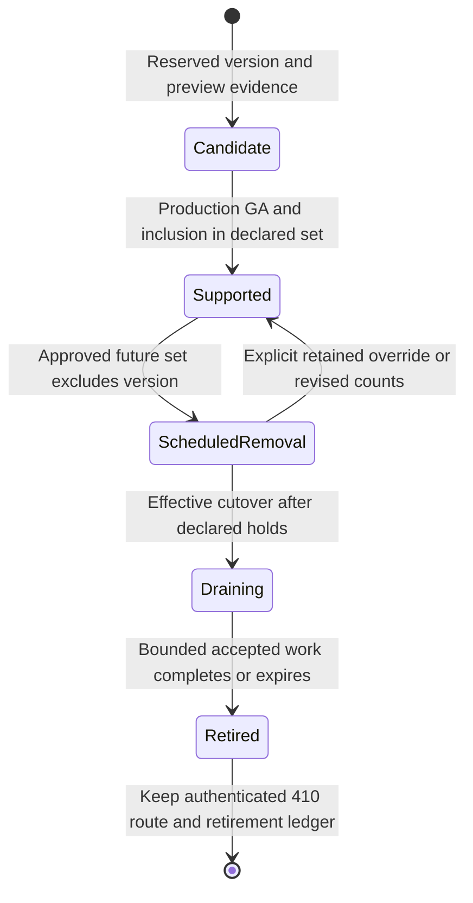

# API versioning, compatibility, and retirement

This is a proposed project standard, not an approved support commitment or evidence of implemented gates. The confirmed policy is a configurable, declared set of supported API versions: versions outside that effective set are automatically retired and their unneeded deployments decommissioned. Clients identify the exact requested version, and responses identify the actual served version. Proposed counts, override controls and timing values below require human approval. Runtime negotiation, the release registry, telemetry, CI checks, and retirement automation remain to be implemented and verified.

This revision replaces the earlier minimum support floors, automatic active-usage holds, and fixed age/inactivity retirement gates. Usage informs explicit retention decisions; it does not silently retain a version forever. A seven-day idle rule is not the controlling support policy.

This document complements [project standards](project-standards.md), [delivery and environments](delivery-and-environments.md), and the [architecture](../architecture.md). It governs the REST contract and observable behavior consumed by the frontend and external integrations. API versions do not grant access rights or preserve obsolete security behavior.

Decision context: [ADR 0002](../decisions/0002-declare-supported-api-versions.md). Event contract compatibility is independently governed by [event contracts](events.md).

## 1. Distinct version identifiers

| Identifier | Meaning | Example |
|---|---|---|
| This document's version | Revision of the proposed governance document | `0.2.0` |
| OpenAPI `openapi` | Specification dialect used to describe the contract | `3.2.1` |
| OpenAPI `info.version` | Version of this API contract artifact | `0.1.0` for the current draft; `1.0.0` for the proposed first GA contract |
| Request version | Exact supported major/minor/patch contract selected by the client | `1.4.7` |
| Response version | Exact contract patch actually served | `1.4.7` |
| Implementation build | Immutable application/container artifact and source revision | Image digest and commit SHA recorded in the deployment registry |

OpenAPI separates the specification version from the API description's information version. Updating the dialect does not itself release a new API. Toolchain support for the chosen dialect remains a delivery gate. [OpenAPI 3.2.1 specification](https://spec.openapis.org/oas/v3.2.1.html#openapi-object).

The draft version does not claim a deployed `/v1` release. Before GA, a release candidate must establish the proposed `1.0.0` contract, generated clients, examples, behavior tests, and a qualified candidate-registry entry. The current `info.version: 0.1.0` remains design-document metadata, not evidence that this candidate exists. Preview publication or deployment remains candidate evidence: it does not establish production availability, GA, or start support/retention clocks. An explicit GA declaration after approved production-readiness qualification establishes the exact release's GA timestamp and production support entry. A new implementation build need not change the API version when its public contract and behavior are unchanged; its provenance and verification evidence still change.

## 2. Client selection and response reporting

The major version is part of the path, for example `/v1/tenants/{tenantId}/patients/{patientId}`. Every application API request must select an exact contract version using the project-defined `API-Version` request header:

```http
GET /v1/tenants/{tenantId}/patients/{patientId}
Authorization: Bearer <access-token>
API-Version: 1.4.7
```

For a successfully resolved request, the response reports the exact served contract:

```http
API-Version: 1.4.7
Cache-Control: no-store
```

These are illustrative future versions, not current deployments. Apply these rules consistently at every ingress and operation:

Production eligibility comes from the declared production support set. Pre-GA qualification uses the separately authorized, environment-scoped candidate-admission rules in section 4; it does not weaken authentication or exact-version selection and does not make a candidate generally available.

- Accept one canonical `MAJOR.MINOR.PATCH` request value, with no leading zeroes, wildcard, range, prerelease, or build suffix. Reject duplicate/conflicting values rather than choosing one. An empty header is invalid; an absent header is a missing required selection.
- The header major must match the path major. A valid `2.0.0` header on `/v1` is a conflict, not an upgrade request.
- There is no default, floating minor/patch alias, or implicit latest selection. `1`, `1.4`, and `latest` are invalid. Every consumer, including the first-party frontend and approved workload clients, explicitly chooses a supported exact version.
- Selecting `1.4.7` never silently serves `1.4.8`. Every safely resolved response reports the exact contract representation actually served, which must equal the requested version. Different implementation builds may serve that same representation during a qualified rollout; build provenance is tracked separately.
- Never fall back from an unknown, retired, or unavailable version to another version. A supported version with temporarily unavailable capacity returns the defined availability error, not a substituted representation.
- A client's exact request is not itself a support-retention override. When that version leaves the effective support set, requests receive the retirement response even if the client continues sending them.

| Selection result | HTTP status | Stable problem code |
|---|---:|---|
| Missing required request version | `400` | `api_version_invalid` |
| Malformed or duplicate request version | `400` | `api_version_invalid` |
| Path/header major conflict | `400` | `api_version_path_mismatch` |
| Well-formed but unknown/unpublished version | `400` | `api_version_unsupported` |
| Known published version retired or outside the effective support set | `410` | `api_version_retired` |

Authenticate the caller before version negotiation or resource semantics. Missing or invalid authentication returns `401` before any version `400`/`410`, with the fixed `WWW-Authenticate: Bearer` challenge and without `API-Version` or policy-version response metadata. Only authenticated, appropriately authorized callers receive version-negotiation outcomes. Use the API's problem-details envelope without echoing raw untrusted header values. Report `API-Version` only when a version was safely resolved; do not invent an exact served patch for negotiation failure. The lifecycle registry, API schemas, and linked developer documentation require authenticated users or approved developer identities with the applicable access grant; absence of patient content is not an anonymous-access exception.

Explicitly allow the request header in CORS and expose `API-Version`, `Deprecation`, `Sunset`, and `Link` to approved browser origins. Narrow CORS transport preflight is not a business API invocation and does not select a patient representation. Keep patient responses `no-store`. Any future permitted cache must vary by exact version as well as the existing tenant/authorization controls; version selection is not an alternative to those controls.

## 3. Semantic compatibility

Use SemVer for released API contracts: incompatible changes require a major release, compatible new functionality a minor release, and compatible fixes a patch release. Published contract artifacts are immutable. Declaring public functionality deprecated belongs in a minor release; previously published lifecycle notices can subsequently be served under this policy without changing a client's selected representation. [Semantic Versioning 2.0.0](https://semver.org/spec/v2.0.0.html).

Compatibility includes the complete consumer-visible contract: requests, responses, error codes, normalization, ordering, pagination/cursors, concurrency and idempotency rules, authentication requirements, field-presence semantics, and documented performance/availability promises. Structural OpenAPI differences are evidence, not the final classifier.

| Change | Required assessment |
|---|---|
| Remove/rename an operation or field; change type, units, identifier meaning, or null/absence semantics | Breaking unless existing supported representations remain fully compatible; otherwise major |
| Add a required request field; tighten accepted values, bounds, formats, or enum members | Breaking for previously valid requests; major |
| Remove an optional request field under strict unknown-field rejection | Breaking for existing clients that send it; major |
| Add an optional request field | Minor only when omitted behavior is unchanged and old requests remain valid |
| Add an optional response field or expand a response enum | Not automatically minor: closed object schemas, strict decoders, generated enums, or exhaustive switches may break |
| Change an error/status code, sort order, cursor interpretation, phone normalization, or idempotency behavior | Behavioral compatibility review and consumer/provider proof; major if existing consumers lose a guarantee |
| Fix behavior to meet an existing guarantee | Patch only after demonstrating compatibility; calling it a bug fix does not make it compatible |
| Change required authentication scheme, scope meaning, or token audience contract | Breaking-contract review; regional provider replacement must also preserve application identity and authorization boundaries |
| Correct an authorization defect or revoke a user's permissions | Apply current security policy to every supported version; no version promises continued unauthorized access |

The current entity contracts use strict object schemas. New response properties and enum values therefore need explicit compatibility evidence; they cannot be labeled additive by convention alone. Preserve every exact representation in the declared support set, including retained older patches. A genuinely incompatible replacement requires a new major even when a client could explicitly opt into another minor or patch. Safely additive capabilities can use new operations or other demonstrably compatible surfaces.

No version can bypass current field restrictions, logging controls, erasure tombstones, tenant isolation, identity revocation, or regional placement. Keep API-shape compatibility separate from live access policy. Resolve emergency security changes through the exception procedure below rather than freezing a vulnerable binary.

## 4. Pull-request and release gates

Every API-affecting pull request must include a change entry containing its affected contract lines, declared severity (`none`, `patch`, `minor`, or `major`), consumer impact, compatibility rationale, migration/deprecation implications, and test evidence. `none` requires a reason when implementation behavior changes. Entries describe changes; they do not independently reserve a final release number.

The proposed CI gate must:

1. Compare the merge candidate against current target-branch `main`, and against the immutable released contract registry for every affected supported line. Re-run in the merge queue; a comparison with the PR's original branch base is insufficient after concurrent merges.
2. Validate the OpenAPI dialect, references, examples, generated Go/TypeScript contracts, and structural differences. Pin tools and document unclassified/unsupported constructs; a tool warning is not compatibility approval.
3. Run provider conformance tests and consumer tests for supported SDK/client generations. Exercise strict response decoders, request validation, enums, optional/null/absent values, errors, pagination, idempotency, identity/provider configuration, field-policy projection, and erasure across all affected views.
4. Compare observed and declared severity. Missing change entries, unclassified behavioral changes, unsupported baselines, failing tests, or unexplained severity reductions block merge/release.
5. Require recorded approval from the human API owner for compatibility classification and the release plan for ordinary application, dependency, contract or policy changes. The expressly approved image-only lane may record an unchanged-contract classification and accept its required evidence automatically under the standing policy, without per-update human approval. It must verify its exact allowed input delta and retain independent AI review, test, provenance, lifecycle and rollout gates. A behavior change, unsupported classification or out-of-policy input stops that lane and returns to ordinary human review. An agent cannot approve its own policy exception or silently waive a gate.

At release time, aggregate all unreleased change entries on `main` for each release train. Compute the next contract version from the immutable last-released baseline and the highest approved severity in the aggregate. Do not repeatedly bump a mutable draft number once per PR: concurrent changes can otherwise reuse versions or accidentally turn several changes into several releases.

Serialize release publication or use atomic registry reservation. Before publication, verify that the baseline and proposed version are still current; if another release won the race, recompute and re-run the release gates. Associate each immutable candidate with a unique candidate/build ID, source/digests and a reserved proposed contract version. Candidate publication is separate from the GA registry: its GA timestamp is null and it is not advertised as production-supported. After the production-readiness and approval gates below, atomically record the immutable GA entry and its approved support/admission policy generation in the authoritative control plane. Include the contract content/digest, changelog, SDK artifacts, qualified implementation builds/cells, approval evidence, effective activation plan and actual GA timestamp. This metadata transaction does not claim simultaneous deployment or activation across Regions. Competing candidates cannot overwrite an existing GA version. Never overwrite a released version or publish different content under the same version. Failed reserved versions remain distinguishable from published releases.

### Candidate qualification and GA activation

Use an explicitly namespaced candidate registry for each authorized ephemeral/preview environment and production release-validation cell. Entries bind environment/cell, candidate/build ID, exact proposed numeric API version, contract digest, implementation digest, policy generation, expiry and the allowed synthetic principals and tenants. Private candidate ingress is a separate deployment route/hostname, not another business operation or an anonymous version endpoint. It is inaccessible to ordinary production clients and data; an arbitrary request header cannot opt into it. Normal bearer authentication, current authorization, tenant/field restrictions, erasure and safe telemetry remain mandatory.

The request and response still use the exact proposed `MAJOR.MINOR.PATCH` value, for example `1.0.0`. Candidate/prerelease/build identifiers are separate registry and evidence fields, never suffixes or aliases accepted by `API-Version`. Replacing a pre-GA candidate creates a new immutable candidate/build entry and invalidates evidence for the earlier candidate. Test reports bind the exact entry and environment, because a reserved version is not yet an immutable GA publication. Candidate admission grants do not add entries to the production support set, consume retention slots, or start GA/retirement clocks.

Run the complete contract, integration and authenticated journey matrix through that isolated route before GA. Production readiness may then be qualified with approved synthetic principals and synthetic tenants on private candidate routes in the intended production cells, without admitting public traffic or granting access to customer data. Record per-cell readiness for the exact digest and configuration; an unready cell cannot be advertised as serving the new version. A passed preview test alone cannot make a production cell ready.

After those gates and the applicable application-release approval, publish the GA/support/admission metadata transaction. Each ready cell conditionally activates the authorized generation and exact version under a routing fence; ordinary client canary and progressive rollout occur only after GA. Activation is coordinated and observed per cell, not an atomic cross-Region deployment. An unhealthy cell retains its prior qualified implementation/generation only for versions still authorized by the effective support policy; requests for a supported version that it cannot yet serve receive the availability response, never a substitute version or a false retirement response. Any rollout hold needed to protect an older version must be explicitly represented in the support set before its cutover. A stale cell cannot use rollout delay to keep an excluded view routable.

If a public canary fails, stop activation and restore an eligible implementation that preserves every still-supported contract and current privacy/erasure controls. Keep the published GA entry and release history immutable; rollback does not make that version unpublished, free its number for reuse, reset GA clocks or silently revive retired routes. If no eligible implementation can serve a still-supported version, report unavailability and invoke the documented recovery/security-exception process. Production support changes still require the declared policy or explicit exception, rather than an implicit side effect of image rollback.

Maintenance patches for older supported lines use that line's own immutable release baseline and regression matrix. Security fixes are carried to every affected supported representation. A single image may implement multiple exact versions; the build manifest enumerates the contract versions that image is qualified to serve. Rebuilding or replacing the image does not silently alter the client's version selection.

## 5. Declared support set and automatic retirement

The versioned support policy defines configurable counts independently across major, minor, and patch levels. Proposed initial values are **two major lines, three minor lines within each selected major, and two patches within each selected minor**. These are pending defaults, not accepted commitments or permanent minimum floors. A policy owner can explicitly increase the counts or retain selected versions when needed.

| Policy input | Proposed meaning |
|---|---|
| `majorCount: 2` | Select the latest two production GA major lines by numeric SemVer order |
| `minorCountPerMajor: 3` | Within each selected major, select its latest three production GA minor lines |
| `patchCountPerMinor: 2` | Within each selected minor, select its latest two production GA patches |
| Exact retained-version overrides | Add explicitly named versions, with an accountable owner, reason, approval, expiry/review date and renewal handling |
| Explicit age/notice holds, if adopted | Add the exact affected versions until their declared dates; no implicit age floor or idle window |

If fewer released versions exist at a selected level, select all available versions at that level. Candidates, preview deployments, pre-GA failed candidates, and reserved version numbers do not count. A release whose public canary fails after GA remains a published GA version; its support and recovery status follow the explicit policy/exception process above. Selection uses the production GA registry, not publication order or image tags. A formerly retired version cannot become available merely because an older image is deployed; reactivation requires an explicit reviewed support-registry change and fresh qualification.

Let the rolling selection be `B`, explicit retained versions be `R`, and declared age/notice holds still in effect be `H`. The authoritative effective support set is **`S = B ∪ R ∪ H`**. Publish its exact version members, policy revision, effective time, approvals, and any scheduled changes. An override retaining one old patch adds that exact version; it does not silently retain every patch, minor or major around it. A line is still partially supported while any of its exact versions remain in `S`.

For example, with a patch count of two, a selected minor serving `1.4.7` and `1.4.8` selects `1.4.8` and `1.4.9` after `1.4.9` becomes production GA. At the declared effective cutover, `1.4.7` retires automatically unless an explicit override or hold includes it. Continued requests for `1.4.7` produce alerts and `410` responses after cutover; they do not keep it running.

The proposed policy does not impose the earlier 24/12-month age floors, 90-day notice, or 90-day inactivity requirements. If the organization wants longer retention or a notice period, configure those requirements explicitly as holds included in `S`, with their scope, start/end conditions, and accountable owner. Customer commitments must be represented by such declared protection or a retained-version override before an affected release/policy change takes effect. The support calculator must not hide undocumented exceptions.

Before activating a support-set change, compute and review its exact additions/removals, assess observed consumers and registered commitments, publish the authenticated lifecycle/migration record, and satisfy the declared notice/hold policy. Active or dormant consumers may motivate an explicit pin or larger counts. Traffic itself neither creates nor renews an override. An unknown telemetry interval must be reported as unknown; it is not an undeclared automatic retention extension.

At the approved effective cutover, the controller automatically removes every version outside `S` from new-request routing, records its retired state, and decommissions deployments that are no longer required. Ordinary execution of an approved policy does not require a fresh manual deletion for each version. A valid request arriving before or after cutover does not reset a clock or cancel retirement. Alert the accountable owner and affected registered consumers through an approved communication process; keeping the version requires a recorded override or policy change.

Retained-version records specify exact version, owner, reason/commitment, approving authority, effective period, expiry/review date, and escalation contacts. Emit renewal alerts before expiry and revalidate the recorded expiry and policy revision at cutover so a concurrent approved renewal cannot be missed. Renewal must be explicit and atomic; traffic cannot renew a pin. A time-limited override with no approved renewal expires according to its declared terms. A non-expiring contractual commitment needs an explicit owner-managed override with scheduled review, not a fabricated expiry. Expiry processing must never silently breach a separately recorded still-effective commitment: surface the conflict for policy correction before scheduling removal.

### Version support lifecycle



Retained and held versions remain fully supported while they belong to `S`. During draining, new requests already receive the retirement response; only bounded work accepted before cutover may finish. Deployment consolidation is separate from contract retirement. Hardened-image jobs use the authoritative deployment lifecycle and must never reactivate a decommissioned target.

## 6. Usage evidence and privacy

Production usage informs support decisions and migration alerts; the declared effective support set governs retirement. Preview/ephemeral tests do not count as production consumers. Record the environment as a trusted bounded label and reconcile each production cell separately. Record version usage after successful authentication identifies a legitimate external caller and after safe version classification, but before operation execution. Count qualified external attempts even when the operation later returns a validation error, authorization denial, no match, conflict, throttling, timeout, or server error. Counting only successful handlers makes an unhealthy integration look unused.

Track authentication failures separately and investigate potential legitimate integration failures. Exclude internal synthetic tests, health probes, migration rehearsals, and monitoring from qualified usage using trusted workload identity/configuration, never a client-controlled `test` header. First-party production browser traffic is real external usage. A denied request from a legitimate registered integration requires investigation rather than automatic exclusion. Neither authenticated traffic nor unauthenticated noise pins a version automatically.

Telemetry uses bounded canonical labels such as registered exact requested version, actual served version, cell/region, operation ID, caller class, and outcome class. Allowlist version labels from the controlled registry and cap historical metric cardinality; unresolved requests use fixed missing/invalid/unknown/conflict/retired classifications rather than arbitrary header text. Record requested and served versions separately so a mismatch becomes an invariant violation. Never use phone inputs, patient data, raw tenant/user IDs, IP addresses, or bearer claims as metric labels. Restrict exact consumer-attribution records to a separate access-controlled lifecycle registry when necessary for approved outreach; pseudonymous references remain protected data.

Collect all qualified attempts rather than sampled traces. Maintain ingestion health, watermark/completeness evidence, a declared retention period, and reconciliation against ingress/request counters. A telemetry outage or unexplained gap makes usage **unknown**, not zero. Flag it in impact reports and alert owners. It does not create an unrecorded retention hold; an owner who wants to delay removal must add an explicit override or update the declared policy before cutover. By contrast, an unavailable or unverifiable authoritative support registry prevents a controller from safely proving removal authority: pause destructive reconciliation until its revision can be verified.

The release/lifecycle registry records every exact version's state and GA date, counts/policy revision, computed set membership, override/hold evidence, effective removal date, notice history, observed use and coverage quality, commitments, approvals, and qualified implementation/deployment mappings. It has no default-version mapping. Store no patient content in that registry.

## 7. Deprecation notices and retirement response

Serve lifecycle headers on responses for the affected representation after authentication and applicable authorization, including eligible errors. Linked lifecycle/schema/developer documentation uses HTTPS and requires an authenticated, authorized user or approved developer identity; HTTPS server authentication alone does not authenticate a caller. Authentication failures do not disclose version-specific lifecycle metadata. `Deprecation` uses a Structured Field Date with `@` followed by Unix seconds; it is not a boolean or HTTP-date. `Sunset` uses HTTP-date and cannot precede the deprecation date. Deprecation alone does not withdraw behavior or service. [RFC 9745](https://www.rfc-editor.org/rfc/rfc9745.html), [RFC 8594](https://www.rfc-editor.org/rfc/rfc8594.html).

Publish `Deprecation` when a version is deprecated and a `Link` with `rel="deprecation"` to its migration policy. Publish a `Sunset` date and a `rel="sunset"` link for its approved effective retirement. A date changes only through an approved support-policy or override update, not merely because traffic continues. Lifecycle metadata communicates the declared policy and removal schedule; it does not create an extra hidden retention rule. Do not send automated outreach messages without authorized recipients and an approved communication process.

After retirement, retain a lightweight authenticated and authorized route/registry response returning `410 api_version_retired` with safe migration information. Keep the retirement ledger independent of the decommissioned application build; it distinguishes former releases from unknown versions. Unknown versions remain `400 api_version_unsupported`; an unsupported typo is not falsely represented as a former release. A retirement response does not claim that a contract was served and omits `API-Version`. Never replay or redirect patient-bearing requests automatically to a different patch, minor, major, or region.

## 8. Deployment, scale-down, and shared data

Hardened-image refresh and inactive-target race handling follow [image maintenance](image-maintenance.md). API behavior and complete client-session journeys follow [API testing](api-testing.md); an unchanged OpenAPI schema is not evidence that a new implementation is compatible.

An exact API contract version is not a service/runtime image version. Prefer one maintained implementation with explicit, tested adapters for multiple exact versions when that is simpler; isolate deployments only for a justified operational requirement. For example, requests for `1.4.7` and `1.4.8` may both run on the same newly hardened image while retaining their respective qualified views. Pinning the API representation never freezes a vulnerable runtime. Removing an obsolete deployment replica is allowed when an eligible healthy build continues to serve every supported representation and the applicable latency/availability guarantees.

Reconcile deployments automatically from the effective support set and qualified build-to-view mappings. At cutover, fence new admissions for excluded views using the policy revision, retain the protected retirement route, and drain already accepted work within its enforced deadline. Allow durable background jobs to finish under current authorization/erasure rules without keeping the retired public endpoint alive. Delete dedicated deployments after that drain. Garbage-collect a shared deployment only when no supported view, required worker or in-flight drain depends on it; removing one patch must not destroy another eligible view's capacity. Recheck the policy epoch immediately before deletion to avoid racing an approved retention renewal.

Do not cold-scale a supported API to zero if startup would violate its availability or latency commitments. An unused supported version can lose dedicated replicas when another qualified deployment still serves it reliably. A version outside the effective set cannot remain routable merely because its shared binary still contains the adapter. Admission and retirement are controlled by the registry, not by accidental handler presence. Image maintenance, rollback, autoscaling and reconciliation must not resurrect a retired route or decommissioned target.

All supported representations use the same authoritative tenant/patient state and the same current authorization, redaction, audit, and erasure controls. Do not duplicate patient databases to preserve old API versions. Data migrations must remain readable/writable through all supported views for their full overlap; use compatibility adapters and staged expand/migrate/contract changes. Do not drop shared fields or state required by a retained view or draining request. Apply erasure and tombstones identically across every version; version retention is never authority to retain otherwise erasable patient content.

Deletion generations/tombstones and regional placement apply identically across versions. Rollback restores compatible code, not erased patients or revoked permissions. Validate rollback against shared schema and policy versions, including completed erasures. A build that cannot safely serve an old representation needs a supported replacement or an explicitly approved emergency restriction, not a silent fallback.

## 9. Security exception and adoption gate

An urgent vulnerability can require an accelerated patch, access restriction, or retirement that does not meet a declared notice/retention hold. A designated human security owner and API owner must authorize the exception, identify affected exact versions, record the risk and rejected alternatives, define communication and recovery, and set an expiry/review point. Record actual emergency action and approval timing; do not fabricate prior signoff. Automations must stop for this decision and cannot infer emergency authority from failing tests or deadlines.

An API support/compatibility exception does not waive the project's required human PR approval or independent AI PR review. Code/configuration changes retain those delivery gates; no unavailable reviewer or urgent deadline is silently treated as a pass. Recovery through an already approved eligible artifact follows the separately documented deployment/rollback process.

Do not preserve a vulnerable binary merely because clients request an exact contract patch. Prefer a secure compatible implementation across all supported views. If a secure compatible implementation is impossible, document the intentional behavior/support exception and its affected consumers instead of claiming ordinary SemVer compatibility.

Before this proposal becomes an active standard, appoint the API/security/support owners; approve the configurable counts, override governance and any declared timing holds; encode contractual commitments; and implement and demonstrate exact-version selection/reporting, CI/release gating, usage quality, notices, automatic retirement, shared-deployment safety and rollback. Verify missing/partial headers, exact patch mismatch, retained overrides, expiry/renewal races, continued traffic at cutover, telemetry gaps, shared-view draining and retired-target image jobs. Record approvals in versioned metadata. Until then, `status: proposed` and `approvers: []` remain accurate.
