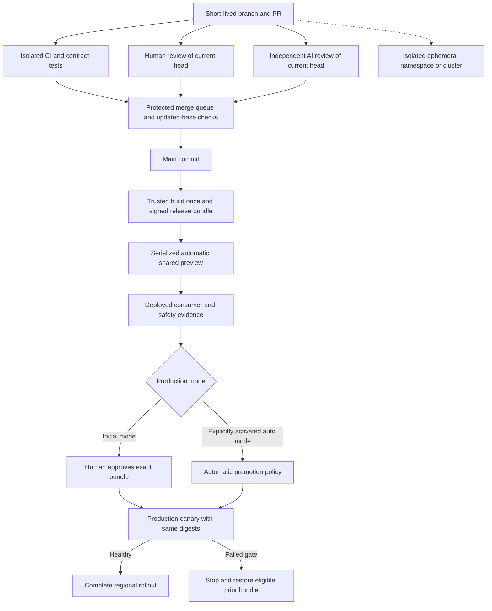

# Delivery and environments standard

This document defines the standalone project's proposed Git, CI/CD, Kubernetes, environment, and release controls. It does not configure a repository, deploy an application, provision infrastructure, or imply that its controls have been implemented. The governance and approval rules in [project standards](./project-standards.md) apply; API compatibility follows [API versioning](./api-versioning.md), and patient-data controls follow the [architecture](../architecture.md).

## Confirmed requirements and proposed defaults

The user has confirmed AWS as the preferred service platform, mandatory Bearer authentication and backend authorization for every API operation, Kubernetes as the deployment platform; a stable shared preview that deploys successful `main` changes automatically; separate ephemeral environments for engineers or pull requests; initial human approval for production promotion; and the ability to explicitly activate automatic production promotion later. Human PR approval and independent AI review remain mandatory for application and policy changes in both production modes. The user approved a narrow automatic image-only maintenance lane under a standing reviewed policy. Kubernetes replaces the earlier ECS hosting proposal; DynamoDB, regional identity, audit, and other managed-service boundaries remain as documented in the architecture.

The controls below are proposed standards for approval. Numbers described as proposed defaults are starting points, not confirmed service commitments. The confirmed browser-visible p95 below 100 ms and 20,000 aggregate requests/second remain requirements; deployment automation cannot redefine their measurement population or count fast failures as success.

## AWS reference toolchain

Prefer AWS-managed capabilities where they fit the required controls. This selection is a documentation baseline, not an implemented pipeline or permission to provision resources. Qualify availability, configuration, quotas, and ownership in each target Region/partition before adoption.

| Capability | AWS reference choice | Required qualification |
|---|---|---|
| Kubernetes runtime | Amazon EKS | Supported Kubernetes/add-on versions, private worker networking, availability zones, pod security and cluster ownership |
| API ingress | Application Load Balancer with AWS WAF, integrated through the qualified EKS load-balancing controller | TLS, approved origins, request-size/rate controls, access-log minimization, private probe routes; WAF is not API authorization |
| Container registry | Amazon ECR | Immutable digest promotion, scanning, approved-signature/provenance verification, controlled retention |
| Build and release orchestration | AWS CodeBuild and AWS CodePipeline | Isolated PR/trusted builds, exact-head checks, signed bundles, serial deployment and environment permissions |
| Git source integration | Git hosting choice pending; AWS CodeConnections where the chosen provider/Region is supported | Protected main, human and independent AI review, merge serialization, narrowly scoped connection permission; do not assume CodeCommit availability |
| Workload/cloud identity | IAM with short-lived service/workload credentials; EKS Pod Identity where supported, or a qualified IAM roles-for-service-accounts configuration | Per-environment/service-account roles, audience/trust restrictions and blocked access to worker-node credentials |
| Secrets and keys | AWS Secrets Manager and AWS KMS | Scoped retrieval, rotation, separate environment keys, no secrets baked into artifacts or emitted to CI logs |
| Build evidence/artifacts | Restricted S3 artifact/evidence buckets, with container images in ECR | Versioned immutable references, encryption, retention, provenance/signature verification and controlled access |
| Observability | AWS Distro for OpenTelemetry collectors and CloudWatch destinations | Source-side/collector allowlists, restricted regional exports, bounded cardinality, no patient payloads in telemetry |

AWS CodeConnections connects supported external repositories to AWS developer services; it does not replace Git-host PR approval or merge controls. [AWS CodeConnections](https://docs.aws.amazon.com/dtconsole/latest/userguide/connections.html). EKS Pod Identity maps Kubernetes service accounts to IAM roles but does not itself isolate containers or prevent access to a permissive node role; restrict node metadata access. [EKS Pod Identity](https://docs.aws.amazon.com/eks/latest/userguide/pod-identities.html). Qualify the ALB integration and its controller instead of assuming a generic Kubernetes ingress creates the required AWS security controls. [EKS ALB ingress](https://docs.aws.amazon.com/eks/latest/userguide/alb-ingress.html).

Git hosting and the exact AI reviewer remain unselected. Required controls stay provider-neutral even though the reference implementation uses CodePipeline/CodeBuild. Do not substitute a non-AWS product merely for convenience; document a concrete AWS capability gap or integration requirement when selecting an alternative.

## Source control and merge gate

Use protected `main` and short-lived branches. Every ordinary change to application code, contracts, dependencies, delivery policy, or configuration enters through a pull request. Qualified image-only pin/provenance updates may use the explicitly authorized protected automation path in [image maintenance](image-maintenance.md); application source and policy changes cannot use it. Direct pushes, force-pushes, and branch-protection bypasses are disabled for normal users and general automation; only the narrowly scoped standing image-maintenance policy may authorize its declared pin-update mechanism. Urgent fixes use an expedited PR with the same human and AI gates; production rollback can use an already approved, eligible release bundle without modifying source.

Before merge:

1. Required CI checks pass for the latest PR head, and integration checks pass against the current `main` merge candidate through a merge queue or equivalent serialization.
2. An authorized human other than the author approves the current head. Required ownership/security reviewers approve changes in their areas.
3. An independent AI review completes against that same head, with blocking findings resolved or explicitly dispositioned by the accountable human reviewer. AI review must not be the author's own assertion that its changes are correct. An unavailable or failed AI review is pending, not a pass.
4. A new commit invalidates prior head-specific approvals and review attestations. Resolve merge conflicts on the branch and repeat the gates; a queue must not introduce unreviewed conflict resolutions. A changed base reruns integration checks, and any resulting changed PR head requires renewed human and AI review.

Record the reviewed SHA, reviewer identities, findings/dispositions, required-check results, merge candidate, and resulting main commit. AI output is advisory evidence plus a required review-completion gate; it cannot replace human approval, approve its own policy exceptions, or grant deployment permission. Automatic application production changes the release gate only, never its human PR gate. The separately approved image-only lane verifies its exact allowed delta and independent checks without per-update human approval.

CI control semantics are provider-neutral. The AWS CodePipeline/CodeBuild configuration and selected Git-host integration must implement them; a provider's green badge or default merge setting is insufficient by itself. Workflow/policy definitions and changes to the set of required checks have their own protected review ownership.

## CI trust boundary and immutable releases

Treat PR code, PR text, dependencies, test output, and instructions encountered by AI reviewers as untrusted input. Run untrusted jobs on isolated, disposable runners with no production credentials, signing authority, writable release cache, or access to privileged runner hosts. AI reviewers receive read-only, narrowly scoped access to the material needed for review. Neither PR jobs nor AI tools receive production deployment identity. Separate untrusted builds from trusted release builds and verify artifact origin when moving between trust domains. A privileged job must not execute an arbitrary artifact or script from an untrusted PR. These controls are provider-neutral applications of established [CI hardening guidance](https://docs.github.com/en/actions/reference/security/secure-use).

Webhook acceptance is permission to consider a candidate, not permission to release it. Authenticate the integration and match the exact repository, event type, actor policy and source revision; anchor any regular-expression identity filters. Recheck the protected merge/review record before a trusted build. Load privileged pipeline definitions and build instructions from the approved control revision, not a PR-supplied buildspec, downloaded script, comment, artifact or URL. Never interpolate PR titles, branch names or test output into executable shell text. A manually approved PR test remains untrusted code execution. [CodeBuild webhook controls](https://docs.aws.amazon.com/codebuild/latest/userguide/webhooks.html).

Restrict who can change a CodeBuild project or call `StartBuild` on a trusted project. Validate or deny buildspec, source, image, environment-variable, service-role, artifact-destination, network and privileged-mode overrides against that project's fixed policy; apply supported IAM condition keys and a trusted invocation gate rather than assuming every parameter has an IAM condition. Limit `iam:PassRole` to the exact intended service role and service. The initiating caller cannot select broader credentials or turn off TLS verification. [StartBuild override surface](https://docs.aws.amazon.com/codebuild/latest/APIReference/API_StartBuild.html), [CodeBuild condition keys](https://docs.aws.amazon.com/codebuild/latest/userguide/action-context-keys.html).

Use separate ephemeral execution pools, artifact prefixes and caches for untrusted tests and trusted releases. A trusted build must not restore a cache writable by an untrusted job. Verify downloaded artifacts as bounded data before use; reject path traversal, symlink escapes, unexpected executables and mismatched digests. Rebuild release artifacts from the approved source instead of promoting an untrusted PR's binary. Build steps cannot read signing keys, change admission/trust policy, write release approvals or assume deployment roles. Where image construction needs privileged execution, isolate that builder from production networks, credentials and other builds; never mount a shared host Docker socket into an untrusted job. [OWASP CI/CD security](https://cheatsheetseries.owasp.org/cheatsheets/CI_CD_Security_Cheat_Sheet.html).

| Identity boundary | Permitted scope | Explicitly excluded authority |
|---|---|---|
| Untrusted PR/test worker | Disposable account/environment resources, synthetic fixtures and bounded candidate outputs | Production/preview secrets, release-cache writes, signing, promotion and control-policy changes |
| Trusted build worker | Approved source and dependency inputs; candidate artifact/SBOM output | Signing-key access, approval attestations, production data and deployment |
| Qualification and attestation services | Exact candidate/evidence validation and their own narrowly scoped attestations | Changing source, publisher trust, support policy or signing a caller-selected arbitrary artifact |
| Preview/production deployment roles | Their own account/cluster, approved resource set and eligible digests | Cross-environment mutation, registry-policy changes, broad secret reads and human approval impersonation |

Trust-role bindings include the intended AWS account, project/repository, workflow or service principal, environment and target resource; use service-supported source-account/source-ARN and token audience/subject conditions where applicable. Test attempted cross-account assumption. Administrators who can change these bindings, signing profiles or required checks are a separate privileged trust boundary with audited, time-bounded access; a normal pipeline must not self-authorize its own wider permissions.

Read-only AI access does not prevent exfiltration. Send only the approved source/diff and sanitized synthetic evidence to an approved reviewer service with recorded data-use, retention and residency terms. Exclude secrets, private keys, tokens, patient data and unrestricted build logs from its inputs. Restrict its filesystem/repository scope, tools and network destinations; no autonomous URL fetch or connector action requested by PR text, no repository write/merge authority, and no cloud credentials. Any test execution occurs in the untrusted sandbox under fixed permissions. Treat generated findings as untrusted text when displaying or consuming them. The review-completion attestation binds the exact head/model/tool profile without giving the model approval authority. [OWASP AI-assisted development controls](https://cheatsheetseries.owasp.org/cheatsheets/Secure_Coding_with_AI_Cheat_Sheet.html).

After merge and successful required checks, the trusted pipeline builds the release candidate once from the exact main commit. Pin dependencies/toolchains and retain lockfiles. Produce immutable service-container/contract artifacts, a software bill of materials, source/build provenance, signatures, and validation evidence. Promotion uses the same content digests tested in preview; mutable tags are convenience labels only. Environment-specific settings and secret references are external, versioned configuration, not a reason to rebuild the application for production. Record their digests/versions with every deployment. [SLSA provenance](https://slsa.dev/spec/v1.2/provenance) provides the provenance vocabulary; this draft does not claim a certified SLSA level.

Use short-lived workload identities for CI, deployment controllers, and Kubernetes workloads. Scope trust to the approved issuer, repository/workflow/ref or service account, environment, and audience; separate build, artifact signing, preview deploy, and production deploy permissions. Avoid long-lived cloud keys and cluster-admin kubeconfigs. Disable automatic Kubernetes API credentials for workloads that do not need them; restrict service-account permissions and token audiences. [Kubernetes service accounts](https://kubernetes.io/docs/concepts/security/service-accounts/).

Each immutable build manifest records the following information available at build time:

- Source commit, build identity, artifact digests, signatures/provenance, SBOM, and review/check attestations.
- Every supported API representation and selector/route, its contract/schema/SDK version and digest, and the allowed implementation digest or set of digests serving it.
- Supported consumer versions and supplied consumer-test artifact references, worker artifacts, policy/configuration versions, and compatibility-test matrix. The consuming team owns frontend builds; this API release must not silently rebuild or deploy their application.
- Required migration/backfill stage, data/key compatibility window, deployment order, rollback-eligible bundle, and any rollback exclusions.
- Build-time validation evidence and the references needed to select a preview/deployment plan.

Preview results, later performance/security evidence, production-mode approvals and actual promotion outcomes are separate immutable attestations issued when those events occur. Each binds the exact build-manifest/image digests and configuration versions, target region/cell and evidence timestamp. The release registry links those attestations; it never edits the signed build manifest to add future results. Gates require the complete matching evidence set before promotion.

Validate the entire bundle as a coherent unit. A route cannot remain active if its representation has no approved, deployed implementation. A legacy API representation does not justify leaving an obsolete binary unpatched: maintain its contract behavior in a patched implementation and rerun its consumer/security tests, or retire it through the versioning policy. Admission and deployment checks verify approved digest identities; an arbitrary valid signature is insufficient. Keep vulnerable/revoked digests out of both forward deployments and rollback eligibility.

Verification checks the artifact subject digest, expected signer and trusted builder identity, approved source repository/commit, build type, resolved inputs and allowed external parameters. It also verifies the separate review/test/promotion attestations against that same subject, environment, policy revision and freshness requirement. Reject unknown parameters, untrusted/self-issued evidence, mismatched subjects, substituted platform manifests and revoked identities. Signature roots and verification policy are controlled independently of the build being evaluated; neither a valid vendor signature nor an image push constitutes release approval. Cache validation only with bounded freshness and revocation invalidation. [SLSA artifact verification](https://slsa.dev/spec/v1.2/verifying-artifacts).

Hardened-image refreshes follow [image maintenance](image-maintenance.md), and evidence at every test layer follows [API testing](api-testing.md). Eligible image-only refreshes automatically test and deploy under the user-approved standing policy, even while application releases remain manual. Out-of-policy inputs or behavior changes return to the ordinary application gates.

## Environment boundaries

| Environment | Purpose | Isolation and data |
|---|---|---|
| Engineer or PR ephemeral | Independent development, integration, and review | Dedicated namespace for trusted workloads, or dedicated disposable cluster where stronger isolation is needed; synthetic patient data and isolated service resources |
| Shared preview | Stable integration URL for the latest successfully deployed passing main release | Persistent Kubernetes environment; dedicated AWS account and cluster separate from production; synthetic datasets and preview-only identity clients |
| Production | Approved customer service | Separate AWS account, Kubernetes cluster(s), IAM, identity configuration, DynamoDB tables, KMS keys, queues, audit stores, and telemetry permissions within each approved residency boundary |

An environment must never choose production resources by falling back to missing configuration. Region/cell ownership is explicit and verified. Preview and ephemeral workloads cannot read production patient data or production secrets. Production dataset copies are not a default fixture source; use generated synthetic records for contact, comment, phone-sharing, authorization, and erasure cases.

A namespace is an organizational boundary, not complete tenant isolation. For a trusted engineer/PR namespace, require owner, PR/branch, environment ID, cost attribution, creation and expiry metadata; scoped RBAC and service accounts; resource quotas/limits; restricted pod security; distinct service credentials; and namespace-specific ingress/TLS and identity redirect configuration. Enforce default-deny ingress and egress with explicit DNS, identity, telemetry, and service exceptions. Verify the cluster network implementation actually enforces the policies. Do not permit host networking, privileged containers, host mounts, or cluster-scoped resource changes in ordinary ephemeral namespaces. [Kubernetes multi-tenancy](https://kubernetes.io/docs/concepts/security/multi-tenancy/), [network policies](https://kubernetes.io/docs/concepts/services-networking/network-policies/).

DynamoDB, SQS, KMS, identity clients, and storage are outside namespace isolation. Give each environment separately scoped resources or an explicitly enforced resource/key boundary, with IAM and application checks that prevent reading or mutating another environment. Prefer dedicated disposable tables/queues for destructive tests; development table counts and costs are governed separately from the production pooled-tenant design. Test isolation rather than assuming resource-name prefixes enforce it.

Untrusted contribution execution, cluster-wide component tests, privileged workloads, or tests that alter admission, networking, operators, or storage drivers require an isolated disposable cluster and suitable cloud account/network boundary. They do not run beside the stable preview merely because they have their own namespace.

Cleanup must revoke identity/credentials, remove ingress/DNS, delete namespace/cluster resources and registered external resources, and reconcile orphans. Namespace deletion alone does not prove that cloud resources or retained volumes disappeared. PR merge/close and expiry trigger cleanup; failed finalizers and failed cloud deletions remain visible until reconciled. Keep minimal deployment evidence under the approved retention policy, not patient fixtures indefinitely.

## EKS workload, administration and secret boundaries

Apply these controls to production, shared preview and release validation, not only ephemeral namespaces. Enforce the Kubernetes **Restricted** Pod Security Standard at admission using the qualified cluster-version policy, with explicit additional controls for read-only root filesystems and bounded writable scratch space. Application, init and debug containers use `runAsNonRoot: true`, `allowPrivilegeEscalation: false`, drop `ALL` Linux capabilities and use `RuntimeDefault` or an approved constrained seccomp profile. Deny privileged mode, host namespaces, host mounts, host networking and unnecessary host ports. Keep exceptions for required platform components narrowly scoped, reviewed and isolated from application nodes where warranted; a workload must not edit the namespace/admission policy that constrains it. [Pod Security Standards](https://kubernetes.io/docs/concepts/security/pod-security-standards/).

Keep the EKS API endpoint private to approved administrative/CI networks or equivalently restrict its approved access path; public unrestricted administration is not the baseline. Separate human administration, deployment and application service accounts. Avoid wildcard RBAC and prohibit application/ordinary deployment access to role `bind`/`escalate`, impersonation, token minting, admission controls, secret listing and other namespaces. Creating pods with another service account can inherit that account's authority: restrict service-account selection, Pod Identity associations and role annotations, not just direct secret reads. Production `exec`, attach, port-forward and ephemeral debug containers require time-limited incident authorization and restricted audit; routine developers and AI reviewers do not receive them. Debug output must follow patient-data restrictions. [Kubernetes RBAC risks](https://kubernetes.io/docs/concepts/security/rbac-good-practices/).

Use distinct Pod Identity/IRSA roles for API, audit, erasure and platform controllers, scoped to exact regional tables/queues/keys and required actions. Deny access to node-instance credentials from application pods and qualify IMDSv2/hop-limit plus actual network controls on the chosen node/runtime configuration. Block both relevant IPv4/IPv6 metadata paths; host-networked pods can otherwise reach IMDS. Preserve only the configured Pod Identity agent access actually needed for workload credentials; indiscriminately blocking every link-local endpoint can break that mechanism. Keep the node role minimal and verify cross-namespace/service-account assumption is denied. [EKS Pod Identity isolation limits](https://docs.aws.amazon.com/eks/latest/userguide/pod-identities.html), [EKS IAM guidance](https://docs.aws.amazon.com/eks/latest/best-practices/identity-and-access-management.html).

Enforce default-deny ingress/egress and explicit service paths in every application namespace. Allow only required AWS endpoints, configured IdP/JWKS destinations, DNS and protected telemetry; use qualified VPC endpoint policies, security groups and controlled egress where IP-only Kubernetes rules cannot express that policy. Do not assume a NetworkPolicy controls node traffic, all link-local endpoints or DNS-based destinations. Untrusted test networks have no route/trust to production and no shared stable-preview credentials. Validate the actual CNI enforcement, including policy installation/restart behavior and IPv6 when enabled. [EKS network controls](https://docs.aws.amazon.com/eks/latest/best-practices/network-security.html).

Retrieve secrets through scoped Secrets Manager/KMS access and short-lived workload identity. Mount only secrets the workload needs with restrictive file permissions where supported; do not place them in images, build arguments, deployment annotations, ordinary logs or general CI artifacts. Avoid environment-variable injection when a safer supported file/in-memory path exists. Kubernetes Secret access, encryption configuration, CSI/provider permissions and rotation propagation require explicit qualification; base64 encoding is not protection. Rotating a secret must invalidate the old credential at its issuer and prove application refresh/restart behavior. Disable core dumps and unrestricted memory/debug exports for patient-handling processes. [OWASP secrets lifecycle](https://cheatsheetseries.owasp.org/cheatsheets/Secrets_Management_Cheat_Sheet.html).

Inventory and maintain EKS control-plane versions, worker-node AMIs, container runtimes, CNI/DNS/CSI components, ingress controllers and admission extensions separately from service containers. Supported versions, vulnerability response, staged rollout/drain budgets and recovery evidence are required for those privileged dependencies too. The service image-only exception does not authorize unreviewed cluster or admission-policy upgrades. Restrict cluster audit/diagnostic content and access; do not enable request-body logging of Secrets or sensitive application resources merely to improve observability. [EKS security guidance](https://docs.aws.amazon.com/eks/latest/best-practices/security.html).

## Edge transport and diagnostic privacy

Publish HTTPS API origins only, with a qualified TLS policy allowing TLS 1.2 or newer, certificate renewal monitoring and approved exact CORS origins. Do not accept patient operations on plaintext listeners or rely on redirecting a sensitive HTTP request after its contents have crossed the network. Use HTTPS target connections for the ALB-to-service hop. **ALB does not validate target certificates**: do not describe that hop as certificate-authenticated backend identity or mTLS. Protect target registration/controller privileges and target security groups so only the approved load balancer reaches the service. If the threat model requires cryptographic backend identity, qualify a validating proxy/transport design explicitly before claiming that property. [ALB target TLS behavior](https://docs.aws.amazon.com/elasticloadbalancing/latest/application/load-balancer-target-groups.html).

Reject direct-origin bypass and unapproved hosts; consume forwarding headers only from the trusted ingress path. Align proxy/application parsing and bounded header/body sizes, decompression, request timeouts and concurrent-work limits; WAF inspection limits must not become application-validation bypasses. Rate controls supplement authenticated tenant fairness, not replace it. Private health/profiling/admin endpoints must not become public through a broad ingress path. Admission rejects unapproved ingress/controller annotations that would widen exposure or override these settings.

WAF/ALB diagnostics have their own privacy boundary. WAF logging redaction does **not** redact sampled requests; disable request sampling for sensitive routes by default, or qualify explicit data protection covering every relevant sample path before enabling it. Redact authorization/cookies and sensitive URL/header components from allowed logs, and verify behavior for blocked, malformed and oversized requests. Disable unneeded request captures; any unavoidable opaque resource references stay in restricted regional diagnostic storage with scoped access and retention, never ordinary logs or AI inputs. Native edge logs are not the durable application audit. [AWS WAF logging and sampling](https://docs.aws.amazon.com/waf/latest/developerguide/logging-management.html).

## Mandatory API authentication at every environment

Every application API operation, including schema/OpenAPI downloads, API documentation, lifecycle/version registry access and administrative routes, requires a valid `Authorization: Bearer <access-token>` and the applicable backend permission. Apply the same rule in ephemeral, preview and production deployments; test identities grant limited synthetic-tenant access rather than bypassing authentication. A protected documentation UI must use an authenticated fetch/session design consistent with this API contract; a public S3 bucket, unprotected ingress route, or signed download URL is not an accidental alternative API authentication scheme. Internal AWS service calls use scoped IAM credentials; that does not replace Bearer authentication for callers of this REST API.

For requests that reach the application API, missing/invalid Bearer credentials produce the canonical `401` before version-selection errors such as `400 api_version_invalid` or `410 api_version_retired`. Authenticate before returning version lifecycle/availability information; authenticated callers must still pass operation, tenant, row and field authorization. Apply safe transport limits and edge abuse controls without executing patient handlers. Do not leak tenant-specific route/version state through an unauthenticated negotiation response. Retirement routes remain authenticated after the patient implementation is removed.

Two boundaries are explicit, not permission to add anonymous API endpoints:

- Kubernetes readiness/liveness and load-balancer health probes use private infrastructure-only listeners/routes protected by network/security-group policy. They expose minimal health state, no patient or version registry data, and are not published as unauthenticated application APIs.
- Browser CORS preflight `OPTIONS` is a minimal transport-only exception: browser preflight does not carry the API Bearer credential. For explicitly approved origins, methods and headers, answer only the required CORS metadata; never invoke a patient handler, read patient data, or return application/registry content. Reject disallowed origins and keep the actual operation behind Bearer authentication and authorization. Do not require a token on preflight and thereby break every approved cross-origin browser request.

Private probes, CORS handling, authenticated schema/docs access and auth-first version errors are required ingress/contract regression tests. Identity-provider login/discovery endpoints follow their own provider security contract; they do not justify an anonymous endpoint in this application API.

## Automatic shared preview

Every successful main change triggers the preview delivery workflow. Build and validate the immutable bundle, then serialize deployment to the shared preview endpoint. Use a monotonic main-sequence/generation and a deployment lease or compare-and-set guard: an older slow pipeline cannot overwrite a newer release. Pending intermediate candidates may be superseded by the newest passing candidate; record supersession explicitly. Do not let canceling a CI job leave an uncontrolled deployment still running.

Preview status exposes desired main SHA, deployed SHA/bundle, in-progress candidate, health, and last deployment failure. After a failed build or rollout, keep or restore the last known good bundle and report that preview is behind. “Tracks main” means converges to the latest passing successfully deployed release; it does not mean preview is always at repository HEAD. Reconciliation retries or a later passing commit can recover it without manual deployment being the default.

Run deployed smoke, contract/consumer, isolation, field-policy, safe-telemetry, and erasure tests before marking a preview release ready for promotion. New exact contract versions are admitted only through the environment-scoped synthetic candidate registry in [API versioning](api-versioning.md). Preview admission is not production GA; pre-GA production validation uses a separate restricted route. Qualified cell readiness and policy-generation checks precede public activation, with immutable GA history preserved if a later canary fails. A persistent preview URL does not require resetting shared fixtures on every deploy; destructive suites use isolated datasets/resources and do not disrupt other reviewers.

The separate image-only lane begins with a verified hardened-image release, rebuilds the exact approved source, tests in an isolated release-validation environment, rechecks the declared supported set and lifecycle epoch, then automatically canaries the signed digest. It does not pass through the ordinary application manual gate or replace shared preview with older source. Its full sequence and eligibility rules are in [image maintenance](image-maintenance.md).

## Production promotion and recovery

Initial mode for ordinary application releases uses an AWS CodePipeline manual-approval action and requires a human release approver to approve the exact immutable bundle, target environment/region, migration state, evidence, and rollback plan after preview validation. An approval for one digest cannot authorize a later rebuilt artifact. Deployment is still automated once approved. The release approver must be an authorized IAM role distinct from the untrusted build/AI identity; the organization defines separation of duties in project standards. Configure the approval action with the exact candidate/evidence references and bind the later deployment to that approved execution/bundle; rejection or expiry does not authorize deployment. [CodePipeline manual approvals](https://docs.aws.amazon.com/codepipeline/latest/userguide/approvals.html).

Automatic production promotion can be activated only by an explicit authorized human decision recorded through the protected policy-change process. Its activation record identifies scope, accountable owner, qualifying evidence, allowed release classes, stop/rollback thresholds, and how to disable it. Require proven rollback and erasure-preserving restore, reliable telemetry, bounded audit failure behavior, and the joint consumer/performance acceptance evidence before activation. Missing evidence keeps manual mode in place. Auto mode promotes only qualifying main bundles that passed preview and all required human-plus-AI PR gates. A policy failure stops promotion; it never silently falls back to permissive rules.

Promote by controlled regional/cell canary with the same digests. Compare contract behavior, error and successful-and-fast rates, latency distributions, authorization/audit health, DynamoDB throttling, and worker backlog against approved bounds. Stop on missing or untrustworthy signals. Kubernetes readiness and a completed Deployment are necessary operational signals, not proof of semantic correctness or browser latency. Progressive traffic control and policy-driven rollback require explicit delivery-controller capabilities; ordinary Deployments do not establish those gates automatically. [Kubernetes Deployments](https://kubernetes.io/docs/concepts/workloads/controllers/deployment/).

Use expand → migrate/backfill → verify → contract changes. Preserve compatibility across the current and rollback application versions and every supported API representation during mixed-version rollout. Migrations run once with fencing, checkpoints, and bounded capacity. Do not roll back data destructively because an image rollout failed. A release that cannot safely roll back needs an explicit forward-recovery plan and human promotion decision; it is ineligible for the initial automatic policy. Rollback preserves field restrictions, revoked identities, erasure tombstones, and deletion generations; a previous application digest cannot resurrect data or restore withdrawn access.

Every production promotion, rollback, pause, and mode change records actor/controller identity, bundle, target, evidence, decision, and observed outcome. Notify the accountable owners of actionable failures. Retain a readily accessible manual stop and the ability to revert automatic mode through the approved operational process.

## Validation evidence and proposed numeric defaults

All supported API representations and supported consumer combinations run contract tests against the deployed bundle. Include absent/null/value semantics, field restrictions, auth-provider conformance, tenant/cursor isolation, compatibility during rolling updates, safe logs, and erasure during concurrent reads/writes. The React consumer's usable visible result is the performance boundary, not a database timer or health endpoint.

The platform security gate must demonstrate denial, not only inspect configuration: attempt PR-controlled build overrides/cache poisoning and forged attestations; attempt cross-account/namespace roles, service-account substitution, privileged/debug pods and IMDS credential access; verify allowed workload credentials still function. Exercise direct-origin and forwarded-header attacks, plaintext/TLS policy, invalid certificate/expired-origin handling under the declared ALB trust model, and synthetic sensitive sentinels in WAF logs/samples and diagnostic paths. Test AI prompt-injection attempts to invoke tools, fetch an exfiltration URL or read an out-of-scope file. Tests run in approved isolated synthetic environments and must leave immutable sanitized evidence; no such controls are claimed implemented by this document.

Use open-loop offered load for the 20,000 aggregate RPS requirement and representative browser probes concurrently against the same deployed candidate. Exercise record sizes, zero/one/maximum matches, endpoint mix, tenant and phone-key skew, updates, cold connections, token refresh, and audit acknowledgement. Report geography/endpoint cohorts, retries, errors, and timeouts; fast failures cannot improve the SLO. A tiny canary or an idle preview smoke test cannot certify the full capacity envelope. Establish production-equivalent capacity evidence before launch and after capacity-sensitive changes; each promotion must identify which current evidence covers its bundle and why. Performance-risk classification itself is reviewed, not decided by an untrusted PR script.

| Operational setting | Proposed starting default; requires approval |
|---|---|
| Ephemeral expiry | 24 hours after last explicitly recorded renewal; renewal limited to 72 hours without owner review |
| Cleanup reconciliation | Every 15 minutes, with alerting on failed cleanup |
| Branch lifetime | Aim for two working days; longer-lived work is split or explicitly reviewed |
| Canary progression | 5%, then 25%, then 100%; at least ten minutes at each partial step, extended until approved sample/cohort requirements are met |
| Initial sustained-load exercise | 60 minutes at 20k aggregate RPS, plus separately agreed bursts and fault tests |

These values are not Kubernetes defaults, an implemented schedule, or proof of safety. Approve concrete error/latency/audit thresholds, sample requirements, availability target, incident ownership, resource quotas, RPO/RTO, retention, and budget before operating production. Do not infer those decisions from the percentages above.
