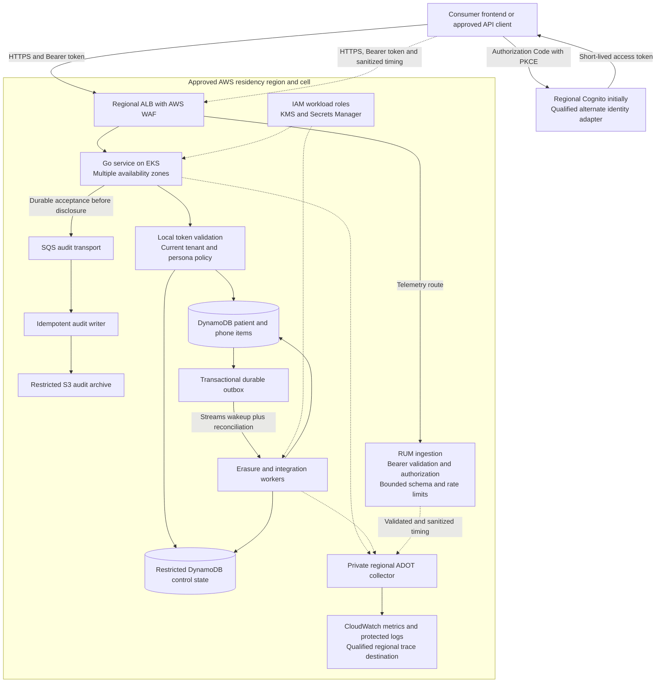
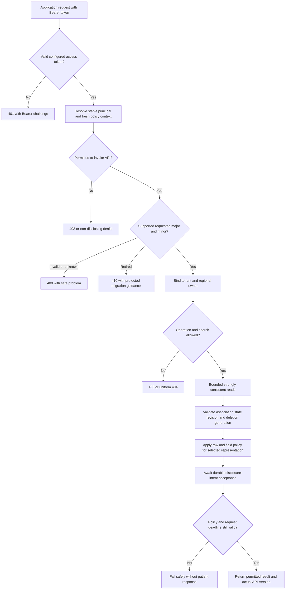

# Architecture, entity relationships and request sequences

These are proposed system diagrams, not deployment evidence. The generated schema ERD in [contract-entities.md](../generated/contract-entities.md) is derived from the OpenAPI schemas; the logical storage/identity ERD below is maintained from the architectural model. Both must be checked when their source changes. Mermaid sources are kept as text for review and future CI rendering.

## Regional AWS architecture



Each application request is authenticated and authorized inside the service. An ingress allow decision or trusted network is insufficient. AWS SDK calls use scoped AWS workload identity, not an end-user token. Key/configuration maintenance is off the normal lookup path; the IAM/KMS/Secrets box does not imply a KMS call per patient request. Control-state access may be served from bounded-fresh local state; its freshness and refresh cost are part of validation.

Browser timing reaches the private collector only through controlled RUM ingestion. That service verifies the bearer token and current authorization, binds allowed context to the verified principal, and enforces a bounded allowlisted schema, payload size, rate limits, and privacy rules. It never accepts patient values, raw claims, or arbitrary caller-selected export destinations. Its observability transport contract requires a separate definition and qualification; this diagram does not add an eighth operation to the seven-operation patient/session OpenAPI contract. The collector has no direct public browser endpoint.

Each approved cell has its own resources and ownership routing. Separate AWS accounts/clusters isolate preview and production. Per-engineer environments isolate external AWS resources as well as Kubernetes workloads. No patient data is replicated globally just to make the diagram's client arrow shorter.

Hardened container images for AWS workloads and their maintenance follow [image maintenance](image-maintenance.md); required contract, security and runtime evidence follows [API testing](api-testing.md). These are documentation requirements, not implemented deployment or test controls.

## Logical data and identity ERD

This ERD describes ownership/reference relationships, not SQL tables or enforced foreign keys. DynamoDB physical keys remain in the architecture's access-pattern table. A phone mapping is an association within one tenant; it is not a global person identity. Erasure/audit references can outlive active patient data under explicit restricted retention, so these arrows do not require retaining a deleted patient item.

```mermaid
erDiagram
    REGIONAL_CELL ||--o{ ORGANIZATION : owns_placement
    ORGANIZATION ||--o{ PATIENT : owns
    PATIENT ||--o{ PHONE_MAPPING : has
    ORGANIZATION ||--o{ MEMBERSHIP : authorizes
    PRINCIPAL ||--o{ MEMBERSHIP : holds
    PRINCIPAL ||--o{ EXTERNAL_IDENTITY : links_explicitly
    ORGANIZATION ||--o{ PERSONA : defines
    PERSONA_TEMPLATE o|--o{ PERSONA : optionally_seeds
    PERSONA ||--|{ PERSONA_REVISION : versions
    PERSONA_REVISION ||--o{ PERSONA_GRANT : contains
    PERMISSION ||--o{ PERSONA_GRANT : identifies
    MEMBERSHIP ||--o{ PERSONA_ASSIGNMENT : receives
    PERSONA_REVISION ||--o{ PERSONA_ASSIGNMENT : granted_as
    PATIENT ||--o{ ERASURE_REQUEST : subject_of
    ORGANIZATION ||--o{ OUTBOX_EVENT : owns_mutation
    ERASURE_REQUEST o|--o{ OUTBOX_EVENT : optionally_schedules
    ORGANIZATION ||--o{ AUDIT_EVENT : scopes
    PRINCIPAL ||--o{ AUDIT_EVENT : acts_in

    ORGANIZATION {
        string tenant_id PK
        string residency_region
        string cell_id
        integer migration_generation
    }
    PATIENT {
        string tenant_id PK
        string patient_id PK
        string revision
        string state
        integer deletion_generation
    }
    PHONE_MAPPING {
        string tenant_id PK
        string key_version PK
        string phone_hmac PK
        string patient_id PK
        string association_revision
    }
    PRINCIPAL {
        string principal_id PK
        string identity_domain
        integer revocation_epoch
    }
    EXTERNAL_IDENTITY {
        string exact_issuer PK
        string exact_subject PK
        string principal_id
    }
    MEMBERSHIP {
        string tenant_id PK
        string principal_id PK
        string policy_version
        string state
    }
    PERSONA_TEMPLATE {
        string template_id PK
        string template_version PK
    }
    PERSONA {
        string tenant_id PK
        string persona_id PK
        string active_revision
        string source_template_id
        string source_template_version
        string policy_version
    }
    PERSONA_REVISION {
        string tenant_id PK
        string persona_id PK
        string revision PK
        string approval_state
        string policy_version
    }
    PERSONA_GRANT {
        string tenant_id PK
        string persona_id PK
        string persona_revision PK
        string permission_id PK
        string resource_scope
        string condition_reference
    }
    PERSONA_ASSIGNMENT {
        string tenant_id PK
        string principal_id PK
        string persona_id PK
        string granted_revision
        string assignment_revision
    }
    PERMISSION {
        string permission_id PK
        string action
        string field_path
    }
    ERASURE_REQUEST {
        string tenant_id PK
        string request_id PK
        string restricted_patient_reference
        string status
    }
    OUTBOX_EVENT {
        string event_id PK
        string tenant_id
        string mutation_kind
        string restricted_resource_reference
        string resource_revision
        string optional_erasure_request_id
        integer deletion_generation
        string delivery_state
    }
    AUDIT_EVENT {
        string event_id PK
        string restricted_actor_reference
        string restricted_resource_reference
        string decision
        string policy_version
    }
    REGIONAL_CELL {
        string cell_id PK
        string aws_region
        string residency_boundary
    }
```



All persona assignments and grants must match the membership's tenant. Each grant belongs to an immutable persona revision; an assignment records the exact approved revision granted. The persona's active-revision pointer cannot bypass current denials or revocation. Template provenance is optional: a tenant can define a persona from scratch. When a template is used, its immutable ID/version is retained and its grants are materialized into the tenant revision; editing a global template must not silently expand existing tenants' privileges. Outbox events belong to the tenant mutation that produced them, including create/update/restrict; only erasure-related events reference an erasure request. Resource references remain restricted metadata. The ERD's `PK` markers indicate logical identity components, not a promise that DynamoDB supports that many separate key attributes. Physical PK/SK construction encodes those components explicitly.

## Application request flow



This shows the successful read path and major denial boundaries. Invalid input, transient datastore errors, unavailable audit transport and revision churn produce the contract's safe errors; they never become a fabricated empty match. Detail reads skip phone-mapping lookup. CORS preflight is transport-only and is not an alternative route into this flow.

## Sign-in and stateless API verification sequence

```mermaid
sequenceDiagram
    participant Client as Consumer client
    participant IdP as Configured regional identity provider
    participant API as Go service
    participant Policy as Local identity and policy state
    Client->>IdP: Authorization Code flow with PKCE, state and nonce
    IdP-->>Client: Access token through validated exchange
    Client->>API: API request, Bearer token, requested version
    API->>API: Verify signature, issuer, token purpose, audience/client and expiry
    alt Invalid credentials
        API-->>Client: 401, no business or version result
    else Valid credentials
        API->>Policy: Resolve principal; verify membership, policy version and revocation freshness
        alt Stale authorization state
            API-->>Client: Safe unavailable/denied result, no patient values
        else Current authorization
            API->>API: Authorize route, tenant, action and later record/field access
            API-->>Client: Authorized contract response
        end
    end
```

The sequence does not call the IdP for every read. Stateless pods do not require sticky sessions; current policy/revocation state still exists and must have a proven freshness mechanism. A token's expiry limits identity validity but does not prove that a persona assignment remains current. Key refresh is bounded maintenance; unknown/unverifiable credentials fail closed. OAuth sign-in endpoints belong to the IdP and are distinct from protected application APIs.

## Exact phone lookup sequence

```mermaid
sequenceDiagram
    participant Client as Consumer client
    participant API as Go service on EKS
    participant DB as Regional DynamoDB
    participant Q as SQS audit queue
    Client->>API: Authenticated POST lookup with base phone and version
    API->>API: Validate token, policy, tenant, version and phone-search permission
    API->>API: Normalize E.164 and compute tenant-scoped HMAC
    API->>DB: Strong Query of tenant-phone mappings
    DB-->>API: Bounded candidate references
    opt Candidates present
        API->>DB: Strong BatchGet of current patient items
        DB-->>API: Records and any UnprocessedKeys
        API->>API: Bounded retry; recheck association/revision/state and row/field policy
    end
    API->>Q: Restricted disclosure-intent event
    Q-->>API: Durable acknowledgment
    API->>API: Recheck request deadline and authorization freshness
    API-->>Client: Permitted matches or legitimate empty result, actual API-Version
    Client->>Client: Render usable result; finish browser measurement
```

Every dependency failure remains subject to the deadline and safe-error contract; the diagram's happy-path arrows do not guarantee latency. Query and BatchGet do not form a snapshot. The maximum page, candidate overscan and retry policy must remain bounded and measurable. An empty result is not permission to discard unresolved reads. Audit acknowledgment proves durable intent acceptance, not browser receipt.

## Erasure, background recovery and restore sequence

```mermaid
sequenceDiagram
    participant Actor as Authorized privacy actor
    participant API as Go service
    participant DB as DynamoDB and durable outbox
    participant Worker as Erasure worker
    participant Copies as Registered downstream copies
    participant Restore as Isolated restore process
    Actor->>API: Authenticated idempotent erasure request
    API->>API: Authorize and evaluate retention or hold policy
    API->>DB: Persist request and decision
    API-->>Actor: 202 accepted with tracked status
    opt Approved for erasure
        API->>DB: Atomic restrict, advance generation and create outbox event
        DB-->>Worker: Stream wakeup or pending-event reconciliation
        Worker->>Worker: Drain bounded prior response work
        Worker->>DB: Delete contact and mappings; preserve protected suppression state
        Worker->>Copies: Idempotent removal requests with generation
        Copies-->>Worker: Completion evidence or tracked retention
        Worker->>DB: Mark active-data erasure; track backup expiry separately
    end
    Restore->>DB: Restore backup into isolated, non-serving tables
    Restore->>Restore: Reapply erasure ledger; reconcile invariants and capacity
    Restore->>Restore: Verify before authorizing live traffic
```

The whole request is scoped to one tenant/patient, not every organization sharing a phone. Retained data and incomplete backup expiry remain explicit statuses. A delayed retry or a restore cannot override a deletion generation. Earlier bytes already transmitted cannot be recalled.

## Delivery and version lifecycle diagrams

The canonical PR-to-preview-to-production diagram is in [delivery and environments](delivery-and-environments.md). The candidate/supported/scheduled-removal/draining/retired API state machine is in [API versioning](api-versioning.md). Those documents define the gates; this page does not duplicate or relax them.

The asynchronous publication and consumption sequence is in [event contracts](events.md), with an [AsyncAPI contract](../contracts/asyncapi.json) for channel/message definitions and CloudEvents envelopes. The REST request sequences remain governed by OpenAPI.
