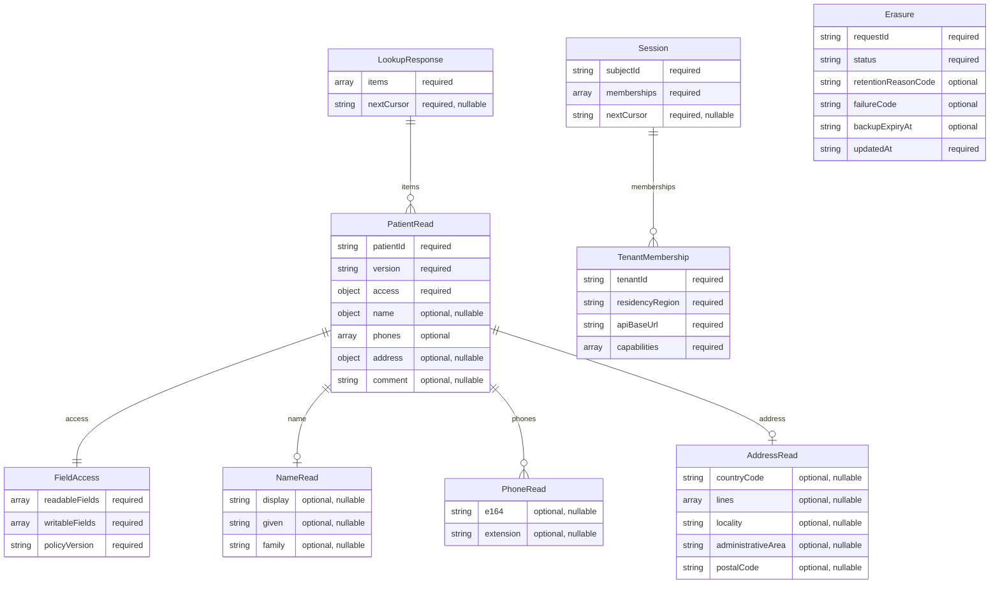

# Contract-derived entity relationships

Generated mechanically from the named `components.schemas` in [canonical OpenAPI](../openapi.json), source SHA256 `976a7553b6a75f7200e4d093b365bf4f9edc1c76f9579962cc50654757462bd6`. This describes API representations and containment, not DynamoDB tables, global identity or enforced foreign keys. Presence/array cardinality comes from schema structure; conditional field authorization still comes from backend policy. Primitive helper types are resolved, and nine selected domain schemas are included. This is a design export, not introspection of a running API.

The [logical storage and persona ERD](../docs/diagrams.md) covers internal entities not exposed by this patient API. Regeneration must preserve the declared selection and reference rules, and future CI must render/validate the Mermaid source as well as compare it for drift.
